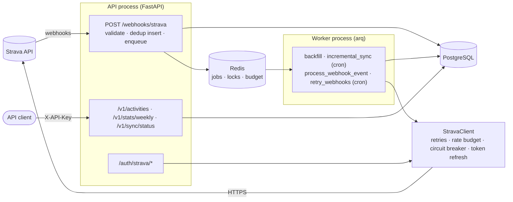

# trainsync

[](https://github.com/umutaydins/trainsync/actions/workflows/ci.yml)

A self-hosted backend that keeps a complete, always-fresh copy of my Strava training data in
PostgreSQL and serves it through my own API.

I wanted to run my own analyses on my training history (weekly volume, trends by sport) without
depending on Strava's UI, its availability, or its rate limits every time I query my data.

## What it does
- Connects a Strava account via OAuth and backfills the full activity history
- Receives Strava webhooks and applies changes asynchronously (create / update / delete / deauthorize)
- Runs incremental syncs as a safety net for missed webhooks
- Serves activities and weekly stats through a typed HTTP API

## How it stays reliable
- Rate-limit-aware Strava client: reads `X-RateLimit-*` headers, two-priority budget, waits for window reset on 429
- Retries with exponential backoff and jitter, circuit breaker, proactive token refresh with a distributed lock
- Idempotent upserts, resumable backfill checkpoints, deduplicated webhook events, dead-letter retries

See [docs/architecture.md](docs/architecture.md) for flows and the
[failure-modes table](docs/architecture.md#failure-modes-this-design-handles) (each row linked to
the fault test that proves it), and [docs/diagrams.md](docs/diagrams.md) for component,
deployment, ER, class, sequence and state diagrams.

## Architecture

The webhook handler never calls Strava: it stores the event and answers in milliseconds. The
worker fetches the activity's current state and upserts it, so duplicate and out-of-order events
end up in the correct final state.

## Stack
Python 3.12 · FastAPI · httpx · PostgreSQL · SQLAlchemy 2 · Alembic · Redis · arq · Prometheus ·
pytest · testcontainers · Docker Compose · GitHub Actions

## Run locally
The compose stack runs postgres, redis, fake_strava (a Strava imitation), a one-shot `migrate`
service, the API and the worker. It needs no Strava account.
```
docker compose up -d --build --wait
open http://localhost:8000/auth/strava/login   # connect the fake athlete
make compose-smoke                             # or: scripted end-to-end check, then tear down
```
If ports 5432/6379 are taken on your machine, set `POSTGRES_HOST_PORT` / `REDIS_HOST_PORT`.

For development against a real Strava app, copy `.env.example` to `.env`, fill it in and run
`uv run alembic upgrade head` and `uv run uvicorn trainsync.main:create_app --factory --reload`.

## API
Interactive docs at http://localhost:8000/docs; the OpenAPI document is committed as
[docs/openapi.json](docs/openapi.json). `/v1` needs an `X-API-Key` (`dev-key-1` in compose).
```
# Newest activities, 50 per page; pass next_cursor back for the next page
curl -s -H 'X-API-Key: dev-key-1' 'http://localhost:8000/v1/activities?limit=50&sport_type=Run'
curl -s -H 'X-API-Key: dev-key-1' 'http://localhost:8000/v1/activities?limit=50&cursor=<next_cursor>'

# Weekly totals (ISO weeks, Monday start, UTC), empty weeks zero-filled
curl -s -H 'X-API-Key: dev-key-1' 'http://localhost:8000/v1/stats/weekly?from=2026-09-01&to=2026-10-18'

# Sync health: runs per athlete, webhook backlog and dead letters, rate-limit usage, circuit state
curl -s -H 'X-API-Key: dev-key-1' http://localhost:8000/v1/sync/status

# Metrics: API on :8000/metrics, worker on :9100/metrics
curl -s http://localhost:8000/metrics | grep strava_
```

## Quality gates
| Command | What it checks |
|---|---|
| `make verify` | ruff (lint + format), mypy `--strict` on `src/` and `fake_strava/`, unit and integration tests (testcontainers Postgres + Redis + fake_strava), branch coverage ≥ 85% (currently 97%) |
| `make test-fault` | one fault-injection test per row of the [failure-modes table](docs/architecture.md#failure-modes-this-design-handles) |
| `make audit` | `pip-audit` over every locked dependency (hash-pinned) |
| `make compose-smoke` | builds the image, starts the whole stack with healthchecks, runs the OAuth flow, tears down |

CI (`.github/workflows/ci.yml`) runs all four, plus a docker job that builds the image and checks
three things: it runs as a non-root user, it has a `HEALTHCHECK`, and it contains no
dev/test/load-test packages. The runtime image is 271 MB (linux/arm64 build on the machine
below).

## Load test results
Measured on 2026-10-18 with `make loadtest` on an Apple M1 MacBook Air (8 cores, 16 GB, fanless).
Docker Desktop's VM had 8 CPUs and 8 GB. Locust ran on the same machine. The compose stack was
seeded with 5,000 fake activities, the athlete connected and the backfill finished before the run.
The API is a single uvicorn process, and the worker processed the incoming webhooks during the run.

**Mixed load**: 50 users (25 webhook senders, 25 API readers), spawn rate 10/s, 2 minutes:

| Endpoint | Requests | RPS | p50 (ms) | p95 (ms) | p99 (ms) | Errors |
|---|---:|---:|---:|---:|---:|---:|
| GET /v1/activities | 5,260 | 44.1 | 38 | 110 | 160 | 0.00% |
| GET /v1/activities (next page) | 10,517 | 88.2 | 38 | 100 | 150 | 0.00% |
| GET /v1/stats/weekly | 1,811 | 15.2 | 44 | 130 | 180 | 0.00% |
| POST /webhooks/strava | 14,362 | 120.4 | 44 | 150 | 220 | 0.00% |
| POST /webhooks/strava (duplicate) | 1,629 | 13.7 | 35 | 110 | 170 | 0.00% |
| **All** | 33,579 | 281.5 | 40 | 130 | 190 | 0.00% |

**Webhook intake only**: 25 webhook senders, 2 minutes
(`LOADTEST_CLASSES=WebhookSender LOADTEST_USERS=25 make loadtest`):

| Endpoint | Requests | RPS | p50 (ms) | p95 (ms) | p99 (ms) | Errors |
|---|---:|---:|---:|---:|---:|---:|
| POST /webhooks/strava | 20,140 | 168.9 | 5 | 11 | 18 | 0.00% |
| POST /webhooks/strava (duplicate) | 2,248 | 18.9 | 5 | 9 | 13 | 0.00% |
| **All** | 22,388 | 187.8 | 5 | 11 | 17 | 0.00% |

About 10% of webhook requests are re-deliveries of an event already sent, which are answered
`duplicate`.

**The Phase 3 webhook target (p99 < 100 ms):**
- Met when the API only takes webhooks: p99 is 18 ms at about 170 POST/s.
- Missed under the mixed load: webhook p99 is 220 ms, at about 280 req/s overall in one API
  process.
- A webhook POST is one INSERT and one Redis write (7 ms p99 in
  `tests/integration/test_webhook_intake.py`). Under mixed load it spends most of its time queued
  behind `/v1` reads in the same event loop and CPU.
- The fix, if it ever matters, is to run more API processes behind a load balancer. That stays
  far under Strava's 2-second deadline in either case. A single athlete produces a few events a
  day, not hundreds per second.

Reproduce: `make loadtest` (needs Docker). Tune it with `LOADTEST_USERS`, `LOADTEST_DURATION`
and `LOADTEST_CLASSES`. The CSVs and summaries land in `loadtest/results/`. The `loadtest`
workflow (manual dispatch) runs the same on a GitHub-hosted runner and uploads the results.

## Design decisions
| ADR | Decision |
|---|---|
| [0001](docs/decisions/0001-string-enums-with-check-constraints.md) | String enums with CHECK constraints instead of native Postgres enums |
| [0002](docs/decisions/0002-redis-lock-for-token-refresh.md) | Per-athlete Redis lock for token refresh (rotating refresh tokens) |
| [0003](docs/decisions/0003-arq-instead-of-celery.md) | arq instead of Celery |
| [0004](docs/decisions/0004-two-priority-rate-budget.md) | Two-priority rate budget shared through Redis |
| [0005](docs/decisions/0005-per-process-circuit-breaker.md) | Per-process circuit breaker, state published for status |
| [0006](docs/decisions/0006-ack-persist-then-process-webhooks.md) | Acknowledge, persist, then process webhooks |
| [0007](docs/decisions/0007-fetch-current-state-on-activity-events.md) | Fetch current state on every activity event, never trust the payload |
| [0008](docs/decisions/0008-webhook-retry-and-dead-letters.md) | Webhook retry cron with backoff; dead letters kept in place |
| [0009](docs/decisions/0009-keyset-pagination.md) | Keyset pagination over offset |
| [0010](docs/decisions/0010-metrics-per-process.md) | Prometheus metrics: one registry per process |

## Status
- [x] Phase 1 — Foundation, OAuth, Strava client
- [x] Phase 2 — Sync engine
- [x] Phase 3 — Webhooks and read API
- [x] Phase 4 — Observability, load test, CI
- [ ] Phase 5 — Web dashboard and Telegram bot
