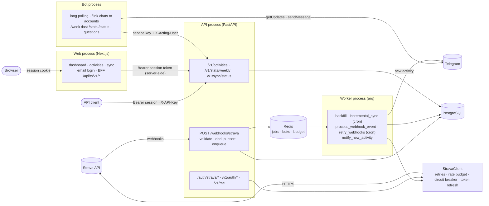
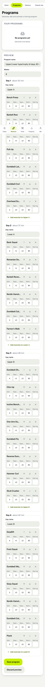
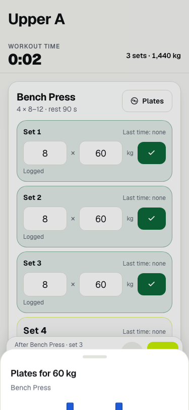
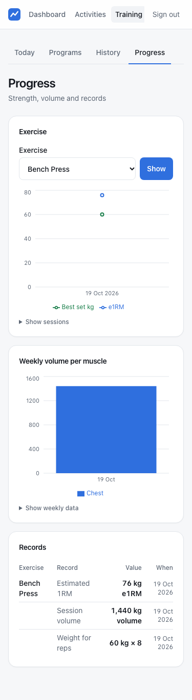
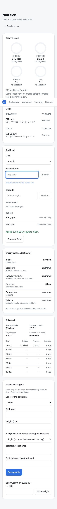

# trainsync

[](https://github.com/umutaydins/trainsync/actions/workflows/ci.yml)

A self-hosted backend that keeps a complete, always-fresh copy of my Strava training data in
PostgreSQL and serves it through my own API.

I wanted to run my own analyses on my training history (weekly volume, trends by sport) without
depending on Strava's UI, its availability, or its rate limits every time I query my data.

## What it does
- Connects a Strava account via OAuth and backfills the full activity history
- Receives Strava webhooks and applies changes asynchronously (create / update / delete / deauthorize)
- Runs incremental syncs as a safety net for missed webhooks
- Serves activities, weekly stats and progress statistics (periods in your time zone compared with
  the period before) through a typed HTTP API
- A small private web dashboard (Next.js): weekly volume, totals by sport, activity list and
  detail, sync status and a "Connect Strava" button
- A Telegram bot that answers `/week`, `/last`, `/stats`, `/status` (and, optionally, plain
  questions through Claude), and announces each new activity exactly once
- Strength training next to the runs: an exercise library, rule-based program generator,
  double progression with suggested weights, a phone-first workout screen (rest timer, plate
  calculator, installable PWA), progress charts and personal records
- Food logging (own foods plus an optional Open Food Facts lookup) with daily and weekly
  summaries and a clearly labelled energy-balance estimate
- An evening check-in in Telegram ("did you train?") that stores the workout or the reason, with
  streaks and adherence on the web
- Invite-only accounts (Phase 8): email + password, per-user data, Strava connection, Telegram
  chat and coach settings; nobody can read another user's rows

## Live demo
`https://<project>-git-…vercel.app` (placeholder until the owner fills in the Vercel preview
URL) — sign in as **`demo@trainsync.invalid`** with the password **`trainsync-demo`**.

The demo is a separate, read-only backend with synthetic data: twelve weeks of runs, rides and
a four-day upper/lower gym program, check-ins, food logs and body weight, all owned by the demo
account and generated by code
([src/trainsync/entrypoints/demo/seed.py](src/trainsync/entrypoints/demo/seed.py), a fixed random seed) and reset every
night. No personal data is in it. Every write except signing in and out answers
`403 This is a read-only demo.`, so the
buttons that log a set or a meal show that message instead of saving. Design:
[ADR 0028](docs/decisions/0028-read-only-demo-with-a-synthetic-seed.md); running it:
[docs/operations.md](docs/operations.md#public-demo).

## How it stays reliable
- Rate-limit-aware Strava client: reads `X-RateLimit-*` headers, two-priority budget, waits for window reset on 429
- Retries with exponential backoff and jitter, circuit breaker, proactive token refresh with a distributed lock
- Idempotent upserts, resumable backfill checkpoints, deduplicated webhook events, dead-letter retries

See [docs/architecture.md](docs/architecture.md) for flows and the
[failure-modes table](docs/architecture.md#failure-modes-this-design-handles) (each row linked to
the fault test that proves it), and [docs/diagrams.md](docs/diagrams.md) for component,
deployment, ER, class, sequence and state diagrams.

## Architecture

The webhook handler never calls Strava: it stores the event and answers in milliseconds. The
worker fetches the activity's current state and upserts it, so duplicate and out-of-order events
end up in the correct final state.

The web app and the bot are plain clients of the read API: they never touch the database. The web
holds no API key: each browser signs in and its API session token travels sealed in an httpOnly
cookie. The bot acts as the user a chat is linked to (ADR 0034, ADR 0036).

## Stack
Python 3.12 · FastAPI · httpx · PostgreSQL · SQLAlchemy 2 · Alembic · Redis · arq · Prometheus ·
pytest · testcontainers · Docker Compose · GitHub Actions

Web: Next.js (App Router) · React · TypeScript · Tailwind · Recharts · Vitest · Playwright.
Bot: Telegram Bot API over plain httpx · Anthropic SDK (optional questions).

## Run locally
The compose stack runs postgres, redis, fake_strava (a Strava imitation), a one-shot `migrate`
service, the API, the worker, the Telegram bot and the web dashboard. It needs no Strava account
and no Telegram token (without one the bot only serves its metrics on :9101).
```
docker compose up -d --build --wait
docker compose exec api python -m trainsync.entrypoints.cli owner set-password
open http://localhost:3000                     # dashboard: owner@example.com + that password
                                               # then Sync → Connect Strava (fake athlete)
curl -si -H 'X-API-Key: dev-key-1' http://localhost:8000/auth/strava/login   # or from the API (as the owner)
make compose-smoke                             # or: scripted end-to-end check, then tear down
```
If ports 5432/6379 are taken on your machine, set `POSTGRES_HOST_PORT` / `REDIS_HOST_PORT`.

Every secret in `docker-compose.yml` is `${VAR:-dev-only default}`: `TOKEN_ENCRYPTION_KEY`,
`STATE_SIGNING_KEY`, `API_KEYS`, `SERVICE_API_KEYS`, `STRAVA_CLIENT_SECRET`,
`STRAVA_WEBHOOK_VERIFY_TOKEN` and `DASHBOARD_SESSION_SECRET` take your own values from
`.env` or the shell, and fall back to clearly labelled DEV-ONLY dummies. The compose stack runs with
`ENV=prod`, so the API, worker and bot (and the web server in production) log a
`dev_default_secrets_in_prod` warning naming every variable still on a dummy. `make compose-smoke`,
`make web-e2e` and `make loadtest` ignore `.env` and always use the dummies.

For development against a real Strava app, copy `.env.example` to `.env`, fill it in and run
`uv run alembic upgrade head` and `uv run uvicorn trainsync.entrypoints.api.app:create_app --factory --reload`.
The bot runs with `uv run python -m trainsync.entrypoints.bot`, the dashboard with `cd web && pnpm install &&
pnpm dev` (it reads the web variables below from its environment).

## Deploy (Phase 7)
Production runs the backend on an always-on MacBook and the dashboard on Vercel, with a separate
read-only demo; it moves to a VPS / Oracle Always Free without code changes
([ADR 0029](docs/decisions/0029-backend-on-a-personal-mac-and-how-to-move-it.md)).

- `compose.prod.yml` + `.env.prod` (template `.env.prod.example`): Postgres and Redis private, a
  Caddy gateway on `127.0.0.1:8080` that forwards only `deploy/gateway/routes.toml`;
  `make prod-check` proves it with dummy secrets (also in CI).
- Tailscale Funnel gives it public HTTPS (`scripts/funnel.sh`); `scripts/mac-prod.sh` starts,
  stops and checks the Mac (`doctor`); a LaunchAgent starts it at login.
- `make deploy` / `make rollback`: green CI required, pre-deploy backup, migrations as a
  one-shot step, smoke test, automatic rollback.
- Nightly encrypted backups to iCloud Drive with a weekly restore check; uptime checked from
  GitHub Actions and stack alerts on Telegram.
- Dashboard on Vercel ([docs/deploy-vercel.md](docs/deploy-vercel.md)); real Strava app and
  webhooks ([docs/strava-setup.md](docs/strava-setup.md)).

Runbook: [docs/operations.md](docs/operations.md), including the owner checks that still have to
be done on the Mac.

## Web dashboard
A private dashboard in `web/`. Every page and every BFF call needs a session cookie: the user
signs in with email + password (`/api/auth/login` → `POST /v1/auth/login`), and the API session
token is sealed in the httpOnly cookie with AES-256-GCM (`DASHBOARD_SESSION_SECRET`). Pages are
server components that read the API with that token as `Authorization: Bearer`; the few
client-side calls ("Load more", the sync page refresh) go to the BFF route `/api/ts/v1/*`, which
forwards only allowlisted method + path pairs (reads, the account under `/v1/me`, owner-only
`/v1/admin`, plus CSRF-checked JSON writes for training, nutrition and check-ins)
([ADR 0011](docs/decisions/0011-server-side-bff.md), [ADR 0034](docs/decisions/0034-accounts-and-opaque-sessions.md)).
Own route handlers: `/api/auth/{login,logout,register,registration,reset}`, `/api/strava/connect`
and `/api/account` (delete). A 401 from the API clears the cookie and sends the browser to
`/login`. `make web-verify` builds with canary
secrets and fails if any of them shows up in a browser-served file.

The screenshots below come from the Playwright run (`make web-e2e`) against the compose stack
with fake Strava data.


| Activities | Activity detail | Sync |
|---|---|---|
|  |  |  |

Dark mode and phone width: [dashboard-dark.png](docs/img/dashboard-dark.png),
[dashboard-mobile.png](docs/img/dashboard-mobile.png).

## Training and nutrition (Phase 6)
Gym training and food logging next to the Strava data (per user since Phase 8), in the API (`/v1/training`,
`/v1/nutrition`, `/v1/checkins`), the dashboard and the bot.

- **Programs**: `/training/programs` generates a full-body, upper/lower or push/pull/legs program
  from days per week, goal, equipment and session length, deterministically and without an LLM
  ([ADR 0018](docs/decisions/0018-rule-based-programs.md)); edit, save, activate.
- **Workout screen** (`/training/workout/<id>`, phone-first): planned sets with last time's
  numbers and the suggested weight (double progression: +2.5 kg, +5 kg for lower body, −10 %
  after two missed sessions), ✓ to log, workout and rest timers that stay right when the screen
  locks, plate calculator, screen wake lock. Each set carries a client-generated id, so a double
  tap or a retry over bad gym Wi-Fi stores one set
  ([ADR 0017](docs/decisions/0017-client-generated-ids-for-set-logging.md),
  [ADR 0021](docs/decisions/0021-web-workout-screen-and-pwa.md)). Installable as a PWA.
- **History and progress**: workouts with volume and records, e1RM and best-set charts per
  exercise, weekly sets and kg per muscle, a PR board, body-weight trend if entered.
- **Nutrition** (`/nutrition`): meals, add food by search or barcode, live kcal and macros,
  targets, weekly averages. The energy balance (Mifflin–St Jeor BMR × activity baseline + calories
  of synced activities) is labelled as an estimate and says "unknown" when Strava has no calorie
  number, never a guess ([ADR 0019](docs/decisions/0019-energy-balance-estimates-and-open-food-facts.md)).
  Neutral wording only.
- **Check-ins** (`/training/checkins`): calendar of daily reports from the bot, streak and
  adherence ([ADR 0020](docs/decisions/0020-daily-check-in.md)).

| Programs | Workout (plate sheet) | Progress | Nutrition |
|---|---|---|---|
|  |  |  |  |

## Telegram bot
A separate process (`python -m trainsync.entrypoints.bot`, compose service `bot`) that long-polls Telegram
([ADR 0012](docs/decisions/0012-telegram-first-behind-a-notifier.md),
[ADR 0013](docs/decisions/0013-plain-httpx-for-the-telegram-bot.md)). A chat is linked to an
account with a one-time code from the dashboard (`/link CODE`, `/unlink`); a chat that is not
linked only gets a "link your account" hint, and every reply uses the linked user's data and
settings ([ADR 0036](docs/decisions/0036-telegram-per-user-and-acting-as.md)).

| Command | Reply |
|---|---|
| `/start`, `/help` | the command list |
| `/link CODE`, `/unlink` | link this chat to your account with the dashboard's code, or unlink it |
| `/week` | this ISO week so far (totals and by sport) vs the whole previous week, with the distance difference |
| `/last` | the latest activity: distance, time, pace or speed, elevation, average heart rate |
| `/stats [week\|month\|3m\|6m\|year\|all]` | progress summary (default `week`): endurance, strength, consistency and food, each with the change against the previous period, and a verdict line (praise or roast in savage; calm when the period had sick or injured check-ins; never body weight) |
| `/stats [4w\|12w\|52w] [sport]` | totals and best week for the period, e.g. `/stats 12w run` |
| `/status` | sync health in one line: last sync, webhooks pending / failed / dead, Strava circuit state, rate-limit usage |
| `/today` | today's planned program day with suggested weights (or what is logged so far) |
| `/plates 102.5` | plates per side for a target weight |
| `/log bench 80x5x3` | log sets into today's workout (starts one if needed); also `80x5,5,4` and `bw x12x3` |
| `/done` | finish the workout: volume, duration, records |
| `/eat <food> <grams>` | log a food from your list (numbered choices when ambiguous) |
| `/kcal` | today's intake vs target, macros |
| `/weight 78.4` | today's body weight |
| `/report` (or "rapor") | start the daily check-in now |
| `/yumusak`, `/sert` | coach soft mode for 24 hours, and back ([ADR 0030](docs/decisions/0030-coach-intensity-and-guardrails.md)) |
| `/lang` (or `/lang tr`, `/lang en`) | the chat's language, stored and kept across restarts; help stays English ([ADR 0031](docs/decisions/0031-runtime-bot-language.md)) |
| `/swear` (or `/swear max`, `/swear roast`) | savage profanity for this chat: `max` swears in every savage message, `roast` only in the roasts; stored like `/lang` ([ADR 0032](docs/decisions/0032-food-roast-profanity-level-and-distress.md)) |

**Daily check-in**: at your check-in time (default `CHECKIN_TIME`, in your account's time zone)
the worker asks once whether you
trained, unless today's check-in exists, and reminds once after `CHECKIN_REMINDER_MINUTES`. With
buttons you walk the planned exercises (as planned, ±2.5 kg, skip, or type `80x5x3`), give a
reason when you skipped, and optionally body weight, sleep and energy. Telegram retries and
double taps never store anything twice. Nutrition and body-weight messages are neutral in every
`BOT_TONE`; rest and sick days are never pushed.

**Coach**: with `BOT_INTENSITY=savage` (and `BOT_TONE=hardcore`) the coach is
deliberately brutal: unrestricted swearing in Turkish or English, excuses and missed work roasted, then one
concrete action for today. Unhealthy choices (junk food, sugar, alcohol, cigarettes, staying up
late, high-sugar or ultra-processed `/eat` logs) get a roast of the choice, one concrete move and
the day's target unchanged. `BOT_PROFANITY=max` (or `/swear max` in the chat) makes every savage
message swear, not only the roasts. The worker also speaks up on its own: before and at a scheduled
workout, nudges when it does not start, "rest is over", and a verdict at the end (any
intensity; quiet hours 23:00–07:00). Hard guardrails hold in every intensity and profanity level:
never body, weight or appearance, no slurs, no push through pain or illness, never skipping meals
or eating below the target, and distress (guilt, purging, not eating, self-hate, bingeing) gets a
calm reply without swearing ([ADR 0030](docs/decisions/0030-coach-intensity-and-guardrails.md),
[ADR 0032](docs/decisions/0032-food-roast-profanity-level-and-distress.md)).

**Progress digests**: every Monday (last week) and on the 1st (last month) at `STATS_DIGEST_TIME`
in your time zone the worker sends the same progress summary as `/stats`, once per period; quiet
hours hold it, an empty period is not sent, and `stats_digest_enabled` in your settings switches
it off ([ADR 0038](docs/decisions/0038-progress-stats-aggregation.md)).

**Natural-language questions** (optional): with `ANTHROPIC_API_KEY` set, any plain text such as
"how far did I run in September?" goes to Claude with four tools that map 1:1 to read endpoints
(summary, weekly, activity list, sync status). Every number in the answer comes from the API, never
from the model ([ADR 0014](docs/decisions/0014-llm-as-a-planner-over-the-read-api.md)). At most 5
tool calls and 20 s per question, and `ASSISTANT_RATE_LIMIT_PER_HOUR` questions per chat (20 by
default). `ASSISTANT_MODEL` defaults to `claude-sonnet-5-5`; set it to another Claude model id
to trade cost against answer quality. Without a key, plain text gets the command list.

**New-activity notifications**: when a Strava webhook announces a new activity, the worker sends
one message to the chat linked to the athlete's account, linking to
`DASHBOARD_PUBLIC_URL/activities/<id>`. A webhook delivered twice still sends one message; a
backfill of old history sends none. Delivery goes through a `Notifier` interface, so another
channel (WhatsApp) can be added without touching the job.

### Setting up a Telegram bot
1. In Telegram, open a chat with [@BotFather](https://t.me/BotFather), send `/newbot`, choose a
   name and a username ending in `bot`. BotFather replies with the token
   (`123456789:AA…`). Treat it like a password: it goes in `.env` or your shell, never in git.
2. Set `TELEGRAM_BOT_TOKEN=<token>`, `TELEGRAM_BOT_USERNAME=<username without @>` and,
   optionally, `ANTHROPIC_API_KEY`. Restart: `docker compose up -d api bot worker` (compose takes
   these from your shell or `.env`).
3. Link your chat: get a code from the dashboard (or `POST /v1/me/telegram/code`) and send
   `/link CODE` to the bot within 10 minutes. Send `/week`.
4. Upgrading a single-user install: the chat in `TELEGRAM_NOTIFY_CHAT_ID` (else the first of
   `TELEGRAM_ALLOWED_CHAT_IDS`) is linked to the owner by migration 0017, so it keeps working
   without a code ([docs/operations.md](docs/operations.md#telegram-linking)).

## Configuration added in Phase 5
All variables are listed with comments in [.env.example](.env.example). Everything here is
optional for the API and the worker; the web app needs one required variable,
`DASHBOARD_SESSION_SECRET`.

| Variable | Used by | Default | Purpose |
|---|---|---|---|
| `OAUTH_RETURN_TO_ALLOWLIST` | API | empty | Browser URLs the OAuth callback may redirect back to (exact match, comma-separated). Empty = the callback always answers JSON ([ADR 0015](docs/decisions/0015-signed-oauth-return-to.md)) |
| `TRAINSYNC_API_URL` | web | `http://localhost:8000` | Where the web server reaches the API |
| `WEB_PUBLIC_URL` | web | `http://localhost:3000` | Browser-facing dashboard URL (the OAuth `return_to`; the only Origin the BFF accepts for writes) |
| `DASHBOARD_SESSION_SECRET` | web | required | Encrypts the session cookie that carries the API session token (AES-256-GCM); at least 32 characters |
| `DASHBOARD_COOKIE_SECURE` | web | `true` in production | Session cookie `Secure` flag; set `false` only for plain-HTTP setups other than localhost |
| `NEXT_PUBLIC_TZ` | web (build time) | `Europe/Istanbul` | Display time zone |
| `TELEGRAM_BOT_TOKEN` | bot, worker | empty | From @BotFather. Empty = the bot only serves metrics and no notifications are sent |
| `TELEGRAM_ALLOWED_CHAT_IDS` | worker, migrations | empty | Since Phase 8 only the owner's bootstrap: migration 0017 links the first one (if no notify chat) to the owner; stack-alert fallback |
| `TELEGRAM_NOTIFY_CHAT_ID` | worker, migrations | first allowlisted chat | The owner's bootstrap chat (linked by migration 0017) and stack-alert chat; notifications go to each user's linked chat |
| `TELEGRAM_API_BASE_URL` | bot, worker | `https://api.telegram.org` | Telegram Bot API base (tests point it at a fake) |
| `BOT_API_BASE_URL` | bot | `http://localhost:8000` | The read API the bot calls |
| `BOT_API_KEY` | bot | first of `SERVICE_API_KEYS` | The key the bot sends; must be a service key to act as linked users |
| `BOT_METRICS_PORT` | bot | `9101` | Bot `/metrics` port |
| `DASHBOARD_PUBLIC_URL` | worker | empty | Notifications link to `<url>/activities/<id>`; empty = no link |
| `ANTHROPIC_API_KEY` | bot | empty | Enables natural-language questions; empty = off |
| `ASSISTANT_MODEL` | bot | `claude-sonnet-5-5` | Claude model for questions |
| `ASSISTANT_RATE_LIMIT_PER_HOUR` | bot | `20` | Questions per chat per hour (counted in Redis) |
| `BOT_TONE`, `BOT_LANG` | bot, worker | `neutral`, `en` | Wording of replies, notifications and the assistant: `neutral` or `hardcore` (a blunt coach, mild profanity, pushes on effort only), `en` or `tr`; compose passes both through ([ADR 0016](docs/decisions/0016-bot-message-packs-and-tone.md)). `BOT_LANG` is the default: `/lang` stores a language per chat ([ADR 0031](docs/decisions/0031-runtime-bot-language.md)) |
| `BOT_INTENSITY` | bot, worker | `normal` | `savage`: the owner's opt-in to an unrestricted, roasting coach (with `hardcore`, either language); guardrails always hold ([ADR 0030](docs/decisions/0030-coach-intensity-and-guardrails.md)) |
| `BOT_PROFANITY` | bot, worker | `roast` | `max`: every savage message swears; `/swear` stores a level per chat ([ADR 0032](docs/decisions/0032-food-roast-profanity-level-and-distress.md)) |
| `SUGAR_LIMIT_G` | bot | `50` | Savage: a day's free sugar (sweets, desserts, sugary drinks, NOVA 4) above this is called out on the next `/eat` |
| `EMERGENCY_NUMBER` | bot, worker | `112` | Named in the calm reply to distress talk |
| `HIGH_SUGAR_PER_100G` | bot | `22.5` | Savage: one `/eat` item above this sugar per 100 g gets a roast (fruit, vegetables, plain dairy never) |
| `WORKOUT_REMINDER_TIME`, `QUIET_HOURS` | worker, bot | `18:00`, `23:00-07:00` | Default start of program days; local window with no proactive coach message |
| `COACH_MESSAGES_ENABLED`, `COACH_MESSAGES_FILE` | worker, bot | on with a bot token, `config/messages.local.yaml` | Timed coach messages; your own extra lines (git-ignored, example in `config/`) |

In compose, the `bot` service takes `TELEGRAM_BOT_TOKEN`, `TELEGRAM_ALLOWED_CHAT_IDS`,
`ANTHROPIC_API_KEY` and `ASSISTANT_MODEL` from your shell or `.env`, and the `worker` takes the Telegram variables and
`DASHBOARD_PUBLIC_URL`; add any other variable to that service's `environment` in
`docker-compose.yml`.

## Configuration added in Phase 6
All optional; defaults in [.env.example](.env.example), and compose passes them through.

| Variable | Used by | Default | Purpose |
|---|---|---|---|
| `GYM_BAR_KG` | API | `20` | Bar weight for the plate calculator |
| `GYM_PLATES` | API | `25x2,20x2,15x2,10x2,5x2,2.5x2,1.25x2` | Plate inventory as `<kg>x<pairs>` |
| `PROGRESSION_INCREMENT_KG`, `PROGRESSION_LOWER_BODY_INCREMENT_KG` | API | `2.5`, `5` | Double-progression step |
| `OPENFOODFACTS_ENABLED` | API | `true` | Food lookup in Open Food Facts (public, no key); `false` = local foods only |
| `OPENFOODFACTS_BASE_URL`, `OPENFOODFACTS_USER_AGENT`, `OPENFOODFACTS_TIMEOUT_S` | API | public API, `trainsync/0.1 (…)`, `3` | Lookup endpoint, the User-Agent OFF asks for, timeout |
| `CHECKIN_ENABLED` | worker | on with a bot token | Evening check-in prompt |
| `CHECKIN_TIME`, `CHECKIN_TZ` | worker, bot | `21:00`, `Europe/Istanbul` | Local prompt time; the zone is also the bot's "today" |
| `CHECKIN_REMINDER_MINUTES` | worker | `90` | One reminder after this many minutes; `0` = none |

## Configuration added in Phase 8
Accounts, tenancy, per-user Strava and Telegram
([ADR 0034](docs/decisions/0034-accounts-and-opaque-sessions.md)–[0037](docs/decisions/0037-strava-per-user-fair-sync-deletion-export.md)).
Defaults in [.env.example](.env.example); `compose.prod.yml` requires `OWNER_EMAIL` and
`SERVICE_API_KEYS`. Upgrading an existing install: [docs/operations.md](docs/operations.md#accounts).

| Variable | Used by | Default | Purpose |
|---|---|---|---|
| `SERVICE_API_KEYS` | API, bot | empty (compose: `dev-bot-key`) | The bot's key(s): the only keys that may send `X-Acting-User` (act as a linked user). The public gateway strips that header |
| `OWNER_EMAIL` | API, migrations | empty | The owner account. Migration 0016 gives every existing row to it (set it before migrating a database with data); `owner set-password` creates it if missing |
| `REGISTRATION_MODE` | API | `invite` | `invite` (an invite code is needed), `open` or `closed` |
| `SESSION_TTL_DAYS` | API | `30` | A session's sliding expiry, extended on use |
| `SESSION_MAX_AGE_DAYS` | API | `90` | Absolute cap from sign-in |
| `SESSION_TOUCH_INTERVAL_S` | API | `3600` | How often the last-seen time and expiry are written at most |
| `INVITE_TTL_DAYS` | API | `7` | Invite code lifetime |
| `RESET_TTL_MINUTES` | API | `60` | Owner-made password reset link lifetime (no email delivery yet) |
| `LOGIN_MAX_FAILURES`, `LOGIN_LOCKOUT_MINUTES` | API | `5`, `15` | Failed logins per email in the window before that email is locked for the window |
| `LOGIN_MAX_FAILURES_PER_IP` | API | `20` | Failed logins per client address in the same window |
| `REGISTER_MAX_PER_HOUR` | API | `5` | Registrations per client address per hour |
| `TELEGRAM_LINK_CODE_TTL_MINUTES` | API | `10` | Lifetime of a `/link` code |
| `TELEGRAM_BOT_USERNAME` | API | empty | The bot's username (no `@`) for the `t.me` link next to the code; empty = no link |
| `BOT_CHAT_CACHE_S` | bot | `60` | Seconds the bot caches chat → user and settings |
| `ASSISTANT_DAILY_LIMIT` | bot | `50` | Questions per user per local day; the owner is exempt |
| `BACKFILL_PAGES_PER_JOB` | worker | `10` | Strava pages per backfill job run; then it re-enqueues so other users' syncs get a turn |

The `BOT_*`, `CHECKIN_*`, `QUIET_HOURS`, `WORKOUT_REMINDER_TIME`, `SUGAR_LIMIT_G` and
`EMERGENCY_NUMBER` values above are now the defaults of a new user's settings; each user's
`PATCH /v1/me/settings` overrides them, and crons run in each user's time zone.

## Configuration added for progress statistics
P8.10, P8.11 ([ADR 0038](docs/decisions/0038-progress-stats-aggregation.md)). Defaults in
[.env.example](.env.example); compose passes the digest variables to the worker, add the others to a service's `environment`.

| Variable | Used by | Default | Purpose |
|---|---|---|---|
| `STATS_CACHE_MIN_DAYS` | API, worker | `180` | Windows of at least this many days are cached in Redis, keyed by the user's data version |
| `STATS_CACHE_TTL_S` | API, worker | `86400` | Lifetime of a cached statistics result |
| `STATS_E1RM_MAX_REPS` | API, worker | `10` | e1RM trend and PRs use working sets of at most this many reps (Epley) |
| `STATS_DIGEST_ENABLED` | worker | on with a bot token | Monday and 1st-of-month progress digests; `false` = off for everyone; otherwise each user's `stats_digest_enabled` setting (null = on) decides |
| `STATS_DIGEST_TIME` | worker | `09:00` | Local time of the digests |

## API
Interactive docs at http://localhost:8000/docs; the OpenAPI document is committed as
[docs/openapi.json](docs/openapi.json). `/v1` needs one of:

- `Authorization: Bearer <session token>` from `POST /v1/auth/login` (people, the web BFF);
- `X-API-Key` from `API_KEYS`, which acts as the owner (scripts, curl, monitors; `dev-key-1` in
  compose);
- a `SERVICE_API_KEYS` key plus `X-Acting-User: <user id>` (only the Telegram bot).

Accounts: `/v1/auth/{registration,register,login,logout,reset}`, `/v1/me` (profile, password,
sessions, settings, export, delete, `strava`, `telegram`), owner-only `/v1/admin/{invites,users}`.
```
# Sign in (any account): {"token": …, "expires_at": …, "user": …}
curl -s -H 'Content-Type: application/json' -d '{"email":"owner@example.com","password":"…"}' \
  http://localhost:8000/v1/auth/login
curl -s -H 'Authorization: Bearer <token>' http://localhost:8000/v1/me

# The examples below use the owner tooling key instead

# Newest activities, 50 per page; pass next_cursor back for the next page
curl -s -H 'X-API-Key: dev-key-1' 'http://localhost:8000/v1/activities?limit=50&sport_type=Run'
curl -s -H 'X-API-Key: dev-key-1' 'http://localhost:8000/v1/activities?limit=50&cursor=<next_cursor>'

# Weekly totals (ISO weeks, Monday start, in the user's time zone), empty weeks zero-filled
curl -s -H 'X-API-Key: dev-key-1' 'http://localhost:8000/v1/stats/weekly?from=2026-09-01&to=2026-10-18'

# Progress (ADR 0038): period = week|last_week|month|last_month|3m|6m|year|12m|all|custom (&from&to);
# the old totals plus endurance, strength, consistency, nutrition and body, each with the change
curl -s -H 'X-API-Key: dev-key-1' 'http://localhost:8000/v1/stats/summary?period=month'
# One zero-filled point per bucket (day|week|month; default by length), optional sport group
curl -s -H 'X-API-Key: dev-key-1' 'http://localhost:8000/v1/stats/series?metric=distance_m&period=3m&bucket=week&sport=run'
# One value per local day of the year: training minutes, sessions, check-in status
curl -s -H 'X-API-Key: dev-key-1' 'http://localhost:8000/v1/stats/heatmap?year=2026'
# e1RM records with the value they beat, newest first (default period all)
curl -s -H 'X-API-Key: dev-key-1' 'http://localhost:8000/v1/stats/prs?period=year&exercise_id=1'

# Sync health: runs per athlete, webhook backlog and dead letters, rate-limit usage, circuit state
curl -s -H 'X-API-Key: dev-key-1' http://localhost:8000/v1/sync/status

# Metrics: API on :8000/metrics, worker on :9100/metrics
curl -s http://localhost:8000/metrics | grep strava_
```

## Quality gates
| Command | What it checks |
|---|---|
| `make verify` | ruff (lint + format), mypy `--strict` on `src/` and `fake_strava/`, unit and integration tests (testcontainers Postgres + Redis + fake_strava), branch coverage ≥ 85% (currently 97%) |
| `make test-fault` | one fault-injection test per row of the [failure-modes table](docs/architecture.md#failure-modes-this-design-handles) |
| `make audit` | `pip-audit` over every locked dependency (hash-pinned) |
| `make compose-smoke` | builds the images, starts the whole stack (including `web` and `bot`) with healthchecks, runs the OAuth flow, checks the web login gate, the BFF and that no response carries the API key, tears down |
| `make web-verify` | web: locked install, eslint, `tsc`, Vitest (BFF, access gate, components, axe), `next build` with canary secrets, then a scan that fails if any secret is in a browser-served file |
| `make web-e2e` | compose stack + Playwright: log in, Connect Strava, backfill, dashboard numbers equal `/v1/stats/summary` and `/v1/stats/weekly`, activity list and detail, sync page, no API key in BFF responses or HTML; writes the screenshots in `docs/img/` |

CI (`.github/workflows/ci.yml`) runs all of these in the `verify`, `audit`, `fault`, `compose`,
`web` and `e2e` jobs, plus a docker job that builds the image and checks
three things: it runs as a non-root user, it has a `HEALTHCHECK`, and it contains no
dev/test/load-test packages. The runtime image is 271 MB (linux/arm64 build on the machine
below).

## Load test results
Measured on 2026-10-18 with `make loadtest` on an Apple M1 MacBook Air (8 cores, 16 GB, fanless).
Docker Desktop's VM had 8 CPUs and 8 GB. Locust ran on the same machine. The compose stack was
seeded with 5,000 fake activities, the athlete connected and the backfill finished before the run.
The API is a single uvicorn process, and the worker processed the incoming webhooks during the run.

**Mixed load**: 50 users (25 webhook senders, 25 API readers), spawn rate 10/s, 2 minutes:

| Endpoint | Requests | RPS | p50 (ms) | p95 (ms) | p99 (ms) | Errors |
|---|---:|---:|---:|---:|---:|---:|
| GET /v1/activities | 5,260 | 44.1 | 38 | 110 | 160 | 0.00% |
| GET /v1/activities (next page) | 10,517 | 88.2 | 38 | 100 | 150 | 0.00% |
| GET /v1/stats/weekly | 1,811 | 15.2 | 44 | 130 | 180 | 0.00% |
| POST /webhooks/strava | 14,362 | 120.4 | 44 | 150 | 220 | 0.00% |
| POST /webhooks/strava (duplicate) | 1,629 | 13.7 | 35 | 110 | 170 | 0.00% |
| **All** | 33,579 | 281.5 | 40 | 130 | 190 | 0.00% |

**Webhook intake only**: 25 webhook senders, 2 minutes
(`LOADTEST_CLASSES=WebhookSender LOADTEST_USERS=25 make loadtest`):

| Endpoint | Requests | RPS | p50 (ms) | p95 (ms) | p99 (ms) | Errors |
|---|---:|---:|---:|---:|---:|---:|
| POST /webhooks/strava | 20,140 | 168.9 | 5 | 11 | 18 | 0.00% |
| POST /webhooks/strava (duplicate) | 2,248 | 18.9 | 5 | 9 | 13 | 0.00% |
| **All** | 22,388 | 187.8 | 5 | 11 | 17 | 0.00% |

About 10% of webhook requests are re-deliveries of an event already sent, which are answered
`duplicate`.

**The Phase 3 webhook target (p99 < 100 ms):**
- Met when the API only takes webhooks: p99 is 18 ms at about 170 POST/s.
- Missed under the mixed load: webhook p99 is 220 ms, at about 280 req/s overall in one API
  process.
- A webhook POST is one INSERT and one Redis write (7 ms p99 in
  `tests/integration/modules/sync/test_webhook_intake.py`). Under mixed load it spends most of its time queued
  behind `/v1` reads in the same event loop and CPU.
- The fix, if it ever matters, is to run more API processes behind a load balancer. That stays
  far under Strava's 2-second deadline in either case. A single athlete produces a few events a
  day, not hundreds per second.

Reproduce: `make loadtest` (needs Docker). Tune it with `LOADTEST_USERS`, `LOADTEST_DURATION`
and `LOADTEST_CLASSES`. The CSVs and summaries land in `loadtest/results/`. The `loadtest`
workflow (manual dispatch) runs the same on a GitHub-hosted runner and uploads the results.

## Design decisions
| ADR | Decision |
|---|---|
| [0001](docs/decisions/0001-string-enums-with-check-constraints.md) | String enums with CHECK constraints instead of native Postgres enums |
| [0002](docs/decisions/0002-redis-lock-for-token-refresh.md) | Per-athlete Redis lock for token refresh (rotating refresh tokens) |
| [0003](docs/decisions/0003-arq-instead-of-celery.md) | arq instead of Celery |
| [0004](docs/decisions/0004-two-priority-rate-budget.md) | Two-priority rate budget shared through Redis |
| [0005](docs/decisions/0005-per-process-circuit-breaker.md) | Per-process circuit breaker, state published for status |
| [0006](docs/decisions/0006-ack-persist-then-process-webhooks.md) | Acknowledge, persist, then process webhooks |
| [0007](docs/decisions/0007-fetch-current-state-on-activity-events.md) | Fetch current state on every activity event, never trust the payload |
| [0008](docs/decisions/0008-webhook-retry-and-dead-letters.md) | Webhook retry cron with backoff; dead letters kept in place |
| [0009](docs/decisions/0009-keyset-pagination.md) | Keyset pagination over offset |
| [0010](docs/decisions/0010-metrics-per-process.md) | Prometheus metrics: one registry per process |
| [0011](docs/decisions/0011-server-side-bff.md) | Server-side BFF instead of calling the API from the browser |
| [0012](docs/decisions/0012-telegram-first-behind-a-notifier.md) | Telegram first, behind a `Notifier` interface |
| [0013](docs/decisions/0013-plain-httpx-for-the-telegram-bot.md) | Plain httpx for the Telegram bot, not aiogram |
| [0014](docs/decisions/0014-llm-as-a-planner-over-the-read-api.md) | LLM as a planner over the read API, never as a data source |
| [0015](docs/decisions/0015-signed-oauth-return-to.md) | Allowlisted `return_to` signed into the OAuth state |
| [0016](docs/decisions/0016-bot-message-packs-and-tone.md) | Bot wording in message packs per tone and language |
| [0017](docs/decisions/0017-client-generated-ids-for-set-logging.md) | Client-generated ids for idempotent set logging |
| [0018](docs/decisions/0018-rule-based-programs.md) | Rule-based programs; LLM optional on top |
| [0019](docs/decisions/0019-energy-balance-estimates-and-open-food-facts.md) | Energy-balance estimates and the Open Food Facts lookup |
| [0020](docs/decisions/0020-daily-check-in.md) | Daily check-in: streaks, adherence, scheduler bookkeeping, conversation state |
| [0021](docs/decisions/0021-web-workout-screen-and-pwa.md) | Web workout screen: timestamp timers, retry queue, PWA without a service worker |
| [0022](docs/decisions/0022-public-gateway-with-a-route-allowlist.md) | Production compose with a public-route gateway (Caddy, path allowlist) |
| [0023](docs/decisions/0023-macos-launchagent-and-control-script.md) | The Mac as a server: a login LaunchAgent and one control script |
| [0024](docs/decisions/0024-encrypted-pg-dump-backups-with-a-restore-check.md) | Nightly encrypted pg_dump to iCloud Drive, GFS retention, scripted restore check |
| [0025](docs/decisions/0025-public-https-with-tailscale-funnel.md) | Public HTTPS with Tailscale Funnel, checked from outside |
| [0026](docs/decisions/0026-manual-make-deploy-instead-of-a-self-hosted-runner.md) | Manual `make deploy` on the Mac instead of a self-hosted GitHub runner |
| [0027](docs/decisions/0027-uptime-and-stack-alerts.md) | Uptime check from GitHub Actions, stack alerts from the worker |
| [0028](docs/decisions/0028-read-only-demo-with-a-synthetic-seed.md) | Public demo: read-only by middleware, synthetic seed as code |
| [0029](docs/decisions/0029-backend-on-a-personal-mac-and-how-to-move-it.md) | Backend on a personal Mac behind Tailscale Funnel; how to move it to a VPS |
| [0030](docs/decisions/0030-coach-intensity-and-guardrails.md) | Coach intensity (savage), timed coach messages and hard guardrails |
| [0031](docs/decisions/0031-runtime-bot-language.md) | Runtime bot language per chat (`/lang`), stored through the API |
| [0032](docs/decisions/0032-food-roast-profanity-level-and-distress.md) | Savage food roast, per-chat profanity level (`/swear`), distress guardrail |
| [0033](docs/decisions/0033-modular-monolith-layout.md) | Modular-monolith layout with enforced layers |
| [0034](docs/decisions/0034-accounts-and-opaque-sessions.md) | Accounts, opaque sessions, invites and owner resets |
| [0035](docs/decisions/0035-tenant-isolation-by-user-id.md) | Tenant isolation by `user_id`, and the single-user migration |
| [0036](docs/decisions/0036-telegram-per-user-and-acting-as.md) | One bot for everyone: chat linking, acting as a user, per-user settings and schedules |
| [0037](docs/decisions/0037-strava-per-user-fair-sync-deletion-export.md) | Strava per user, fair sync, account deletion and data export |
| [0038](docs/decisions/0038-progress-stats-aggregation.md) | Progress statistics: local-day SQL aggregation, period rules, trigger-versioned cache |

## Status
- [x] Phase 1 — Foundation, OAuth, Strava client
- [x] Phase 2 — Sync engine
- [x] Phase 3 — Webhooks and read API
- [x] Phase 4 — Observability, load test, CI
- [x] Phase 5 — Web dashboard and Telegram bot
- [x] Phase 6 — Strength training, programs and nutrition
- [ ] Phase 7 — Deploy (Mac backend + Vercel web) — built and tested; waiting for the owner checks in [docs/operations.md](docs/operations.md#owner-checks) ([evidence](docs/phases/phase-7-deploy.md#evidence))
- [x] Phase 8 — Multi-user (invite-only accounts, per-user data, Strava and Telegram) and progress statistics (P8.10 API, P8.11 bot `/stats` and weekly / monthly digests) — deployed together with Phase 7 once its owner checks pass; dashboard pages for sign-up, reset and settings follow in the web UI tasks
- [ ] Phase 9 — Body composition, Apple Health and adaptive programs
