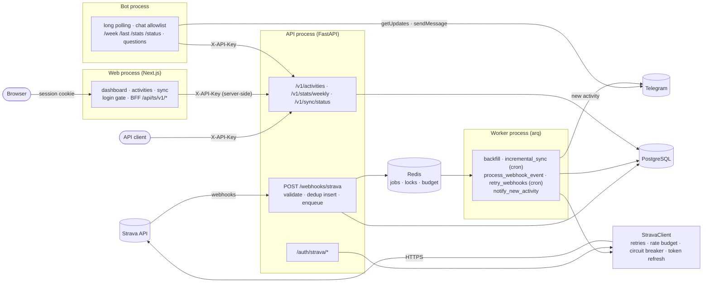
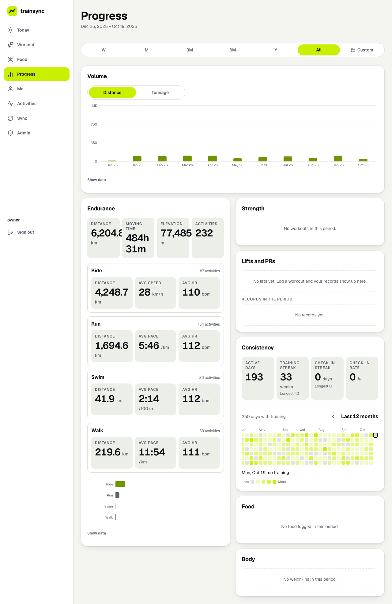
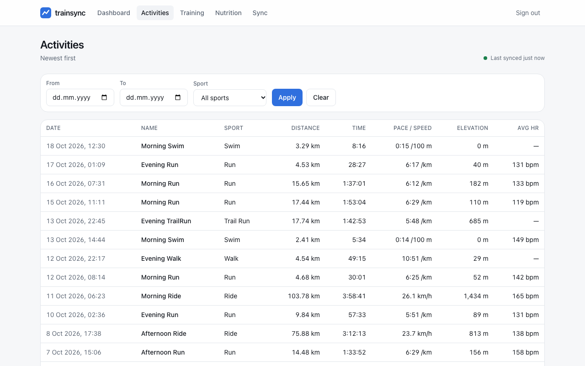
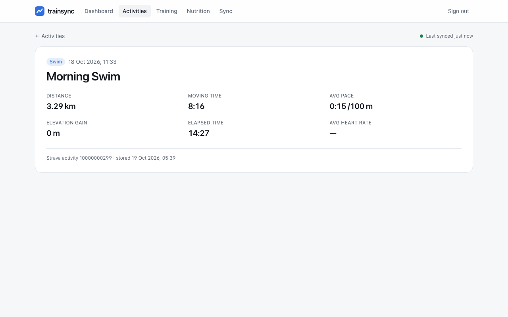
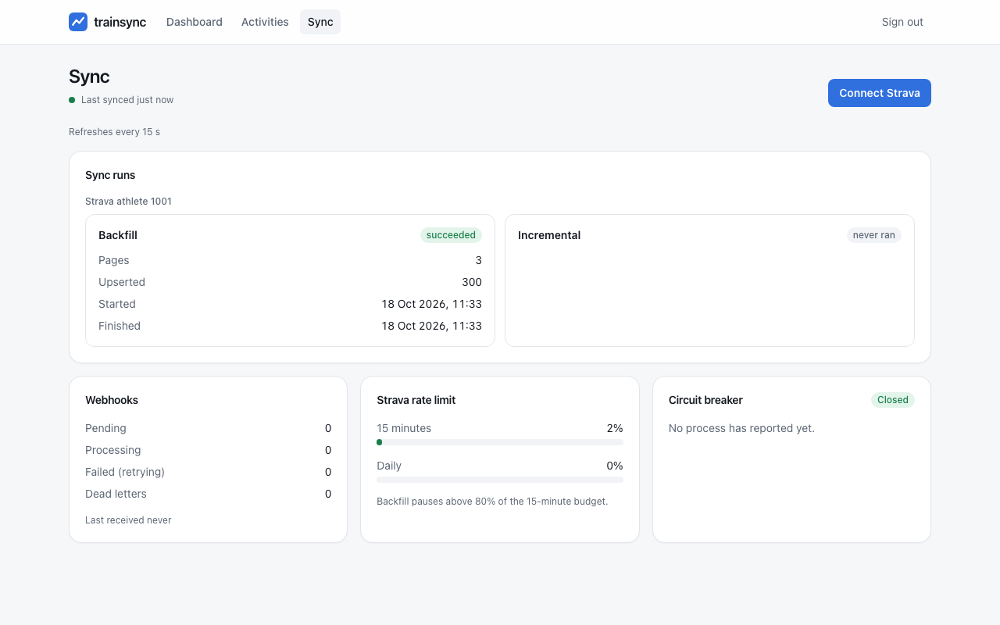

# trainsync

[](https://github.com/umutaydins/trainsync/actions/workflows/ci.yml)

A self-hosted backend that keeps a complete, always-fresh copy of my Strava training data in
PostgreSQL and serves it through my own API.

I wanted to run my own analyses on my training history (weekly volume, trends by sport) without
depending on Strava's UI, its availability, or its rate limits every time I query my data.

## What it does
- Connects a Strava account via OAuth and backfills the full activity history
- Receives Strava webhooks and applies changes asynchronously (create / update / delete / deauthorize)
- Runs incremental syncs as a safety net for missed webhooks
- Serves activities and weekly stats through a typed HTTP API
- A small private web dashboard (Next.js): weekly volume, totals by sport, activity list and
  detail, sync status and a "Connect Strava" button
- A Telegram bot that answers `/week`, `/last`, `/stats`, `/status` (and, optionally, plain
  questions through Claude), and announces each new activity exactly once

## How it stays reliable
- Rate-limit-aware Strava client: reads `X-RateLimit-*` headers, two-priority budget, waits for window reset on 429
- Retries with exponential backoff and jitter, circuit breaker, proactive token refresh with a distributed lock
- Idempotent upserts, resumable backfill checkpoints, deduplicated webhook events, dead-letter retries

See [docs/architecture.md](docs/architecture.md) for flows and the
[failure-modes table](docs/architecture.md#failure-modes-this-design-handles) (each row linked to
the fault test that proves it), and [docs/diagrams.md](docs/diagrams.md) for component,
deployment, ER, class, sequence and state diagrams.

## Architecture

The webhook handler never calls Strava: it stores the event and answers in milliseconds. The
worker fetches the activity's current state and upserts it, so duplicate and out-of-order events
end up in the correct final state.

The web app and the bot are plain clients of the read API: they never touch the database, and the
API key never reaches the browser.

## Stack
Python 3.12 · FastAPI · httpx · PostgreSQL · SQLAlchemy 2 · Alembic · Redis · arq · Prometheus ·
pytest · testcontainers · Docker Compose · GitHub Actions

Web: Next.js (App Router) · React · TypeScript · Tailwind · Recharts · Vitest · Playwright.
Bot: Telegram Bot API over plain httpx · Anthropic SDK (optional questions).

## Run locally
The compose stack runs postgres, redis, fake_strava (a Strava imitation), a one-shot `migrate`
service, the API, the worker, the Telegram bot and the web dashboard. It needs no Strava account
and no Telegram token (without one the bot only serves its metrics on :9101).
```
docker compose up -d --build --wait
open http://localhost:3000                     # dashboard, password: dev-only-dashboard-password
                                               # then Sync → Connect Strava (fake athlete)
open http://localhost:8000/auth/strava/login   # or connect from the API directly (JSON answer)
make compose-smoke                             # or: scripted end-to-end check, then tear down
```
If ports 5432/6379 are taken on your machine, set `POSTGRES_HOST_PORT` / `REDIS_HOST_PORT`.

For development against a real Strava app, copy `.env.example` to `.env`, fill it in and run
`uv run alembic upgrade head` and `uv run uvicorn trainsync.main:create_app --factory --reload`.
The bot runs with `uv run python -m trainsync.bot`, the dashboard with `cd web && pnpm install &&
pnpm dev` (it reads the web variables below from its environment).

## Web dashboard
A private, single-user dashboard in `web/`. Every page and every BFF call needs a signed session
cookie (one password, `DASHBOARD_PASSWORD`). Pages are server components that read the API with
the key held on the server; the few client-side calls ("Load more", the sync page refresh) go to
the BFF route `/api/ts/v1/*`, which only forwards GETs on five read paths and adds the key there
([ADR 0011](docs/decisions/0011-server-side-bff.md)). `make web-verify` builds with canary
secrets and fails if any of them shows up in a browser-served file.

The screenshots below come from the Playwright run (`make web-e2e`) against the compose stack
with fake Strava data.



| Activities | Activity detail | Sync |
|---|---|---|
|  |  |  |

Dark mode and phone width: [dashboard-dark.png](docs/img/dashboard-dark.png),
[dashboard-mobile.png](docs/img/dashboard-mobile.png).

## Telegram bot
A separate process (`python -m trainsync.bot`, compose service `bot`) that long-polls Telegram
([ADR 0012](docs/decisions/0012-telegram-first-behind-a-notifier.md),
[ADR 0013](docs/decisions/0013-plain-httpx-for-the-telegram-bot.md)). It answers only chats in
`TELEGRAM_ALLOWED_CHAT_IDS`; any other chat gets no reply at all.

| Command | Reply |
|---|---|
| `/start`, `/help` | the command list |
| `/week` | this ISO week so far (totals and by sport) vs the whole previous week, with the distance difference |
| `/last` | the latest activity: distance, time, pace or speed, elevation, average heart rate |
| `/stats [4w\|12w\|52w] [sport]` | totals and best week for the period (default `4w`), e.g. `/stats 12w run` |
| `/status` | sync health in one line: last sync, webhooks pending / failed / dead, Strava circuit state, rate-limit usage |

**Natural-language questions** (optional): with `ANTHROPIC_API_KEY` set, any plain text such as
"how far did I run in September?" goes to Claude with four tools that map 1:1 to read endpoints
(summary, weekly, activity list, sync status). Every number in the answer comes from the API, never
from the model ([ADR 0014](docs/decisions/0014-llm-as-a-planner-over-the-read-api.md)). At most 5
tool calls and 20 s per question, and `ASSISTANT_RATE_LIMIT_PER_HOUR` questions per chat (20 by
default). `ASSISTANT_MODEL` defaults to `claude-sonnet-5-5`; set it to another Claude model id
to trade cost against answer quality. Without a key, plain text gets the command list.

**New-activity notifications**: when a Strava webhook announces a new activity, the worker sends
one message to `TELEGRAM_NOTIFY_CHAT_ID` (default: the first allowlisted chat), linking to
`DASHBOARD_PUBLIC_URL/activities/<id>`. A webhook delivered twice still sends one message; a
backfill of old history sends none. Delivery goes through a `Notifier` interface, so another
channel (WhatsApp) can be added without touching the job.

### Setting up a Telegram bot
1. In Telegram, open a chat with [@BotFather](https://t.me/BotFather), send `/newbot`, choose a
   name and a username ending in `bot`. BotFather replies with the token
   (`123456789:AA…`). Treat it like a password: it goes in `.env` or your shell, never in git.
2. Find your chat id. Send any message to your new bot, then either
   - run `curl -s "https://api.telegram.org/bot<TOKEN>/getUpdates"` while the trainsync bot is
     **not** running and read `result[].message.chat.id`, or
   - start the bot with the token and an empty allowlist and send it a message: it does not
     reply, but logs `bot_chat_denied` with the `chat_id` (`docker compose logs bot`).
3. Set `TELEGRAM_BOT_TOKEN=<token>` and `TELEGRAM_ALLOWED_CHAT_IDS=<chat id>` (comma-separated
   for more than one chat; a group's id is negative). Optionally `TELEGRAM_NOTIFY_CHAT_ID` and
   `ANTHROPIC_API_KEY`.
4. Restart: `docker compose up -d bot worker` (compose takes these from your shell or `.env`). Send
   `/week` to the bot.

## Configuration added in Phase 5
All variables are listed with comments in [.env.example](.env.example). Everything here is
optional for the API and the worker; the web app needs its three required ones (`TRAINSYNC_API_KEY`, `DASHBOARD_PASSWORD`, `DASHBOARD_SESSION_SECRET`).

| Variable | Used by | Default | Purpose |
|---|---|---|---|
| `OAUTH_RETURN_TO_ALLOWLIST` | API | empty | Browser URLs the OAuth callback may redirect back to (exact match, comma-separated). Empty = the callback always answers JSON ([ADR 0015](docs/decisions/0015-signed-oauth-return-to.md)) |
| `TRAINSYNC_API_URL` | web | `http://localhost:8000` | Where the web server reaches the API |
| `TRAINSYNC_API_KEY` | web | required | Sent as `X-API-Key` by the web server only; one of `API_KEYS` |
| `TRAINSYNC_PUBLIC_API_URL` | web | `http://localhost:8000` | Browser-facing API URL (the Connect Strava link) |
| `WEB_PUBLIC_URL` | web | `http://localhost:3000` | Browser-facing dashboard URL (the OAuth `return_to`) |
| `DASHBOARD_PASSWORD` | web | required | The single-user login password (5 failed attempts per address per 15 min, then 429) |
| `DASHBOARD_SESSION_SECRET` | web | required | Signs the session cookie; at least 32 characters |
| `DASHBOARD_COOKIE_SECURE` | web | `true` in production | Session cookie `Secure` flag; set `false` only for plain-HTTP setups other than localhost |
| `NEXT_PUBLIC_TZ` | web (build time) | `Europe/Istanbul` | Display time zone |
| `TELEGRAM_BOT_TOKEN` | bot, worker | empty | From @BotFather. Empty = the bot only serves metrics and no notifications are sent |
| `TELEGRAM_ALLOWED_CHAT_IDS` | bot, worker | empty | Chats the bot answers (comma-separated) |
| `TELEGRAM_NOTIFY_CHAT_ID` | worker | first allowlisted chat | Where new-activity notifications go |
| `TELEGRAM_API_BASE_URL` | bot, worker | `https://api.telegram.org` | Telegram Bot API base (tests point it at a fake) |
| `BOT_API_BASE_URL` | bot | `http://localhost:8000` | The read API the bot calls |
| `BOT_API_KEY` | bot | first of `API_KEYS` | The key the bot sends |
| `BOT_METRICS_PORT` | bot | `9101` | Bot `/metrics` port |
| `DASHBOARD_PUBLIC_URL` | worker | empty | Notifications link to `<url>/activities/<id>`; empty = no link |
| `ANTHROPIC_API_KEY` | bot | empty | Enables natural-language questions; empty = off |
| `ASSISTANT_MODEL` | bot | `claude-sonnet-5-5` | Claude model for questions |
| `ASSISTANT_RATE_LIMIT_PER_HOUR` | bot | `20` | Questions per chat per hour (counted in Redis) |
| `BOT_TONE`, `BOT_LANG` | bot, worker | `neutral`, `en` | Wording of replies, notifications and the assistant: `neutral` or `hardcore` (a blunt coach, mild profanity, pushes on effort only), `en` or `tr`; compose passes both through ([ADR 0016](docs/decisions/0016-bot-message-packs-and-tone.md)) |

In compose, the `bot` service takes `TELEGRAM_BOT_TOKEN`, `TELEGRAM_ALLOWED_CHAT_IDS`,
`ANTHROPIC_API_KEY` and `ASSISTANT_MODEL` from your shell or `.env`, and the `worker` takes the Telegram variables and
`DASHBOARD_PUBLIC_URL`; add any other variable to that service's `environment` in
`docker-compose.yml`.

## API
Interactive docs at http://localhost:8000/docs; the OpenAPI document is committed as
[docs/openapi.json](docs/openapi.json). `/v1` needs an `X-API-Key` (`dev-key-1` in compose).
```
# Newest activities, 50 per page; pass next_cursor back for the next page
curl -s -H 'X-API-Key: dev-key-1' 'http://localhost:8000/v1/activities?limit=50&sport_type=Run'
curl -s -H 'X-API-Key: dev-key-1' 'http://localhost:8000/v1/activities?limit=50&cursor=<next_cursor>'

# Weekly totals (ISO weeks, Monday start, UTC), empty weeks zero-filled
curl -s -H 'X-API-Key: dev-key-1' 'http://localhost:8000/v1/stats/weekly?from=2026-09-01&to=2026-10-18'

# Sync health: runs per athlete, webhook backlog and dead letters, rate-limit usage, circuit state
curl -s -H 'X-API-Key: dev-key-1' http://localhost:8000/v1/sync/status

# Metrics: API on :8000/metrics, worker on :9100/metrics
curl -s http://localhost:8000/metrics | grep strava_
```

## Quality gates
| Command | What it checks |
|---|---|
| `make verify` | ruff (lint + format), mypy `--strict` on `src/` and `fake_strava/`, unit and integration tests (testcontainers Postgres + Redis + fake_strava), branch coverage ≥ 85% (currently 97%) |
| `make test-fault` | one fault-injection test per row of the [failure-modes table](docs/architecture.md#failure-modes-this-design-handles) |
| `make audit` | `pip-audit` over every locked dependency (hash-pinned) |
| `make compose-smoke` | builds the images, starts the whole stack (including `web` and `bot`) with healthchecks, runs the OAuth flow, checks the web login gate, the BFF and that no response carries the API key, tears down |
| `make web-verify` | web: locked install, eslint, `tsc`, Vitest (BFF, access gate, components, axe), `next build` with canary secrets, then a scan that fails if any secret is in a browser-served file |
| `make web-e2e` | compose stack + Playwright: log in, Connect Strava, backfill, dashboard numbers equal `/v1/stats/summary` and `/v1/stats/weekly`, activity list and detail, sync page, no API key in BFF responses or HTML; writes the screenshots in `docs/img/` |

CI (`.github/workflows/ci.yml`) runs all of these in the `verify`, `audit`, `fault`, `compose`,
`web` and `e2e` jobs, plus a docker job that builds the image and checks
three things: it runs as a non-root user, it has a `HEALTHCHECK`, and it contains no
dev/test/load-test packages. The runtime image is 271 MB (linux/arm64 build on the machine
below).

## Load test results
Measured on 2026-10-18 with `make loadtest` on an Apple M1 MacBook Air (8 cores, 16 GB, fanless).
Docker Desktop's VM had 8 CPUs and 8 GB. Locust ran on the same machine. The compose stack was
seeded with 5,000 fake activities, the athlete connected and the backfill finished before the run.
The API is a single uvicorn process, and the worker processed the incoming webhooks during the run.

**Mixed load**: 50 users (25 webhook senders, 25 API readers), spawn rate 10/s, 2 minutes:

| Endpoint | Requests | RPS | p50 (ms) | p95 (ms) | p99 (ms) | Errors |
|---|---:|---:|---:|---:|---:|---:|
| GET /v1/activities | 5,260 | 44.1 | 38 | 110 | 160 | 0.00% |
| GET /v1/activities (next page) | 10,517 | 88.2 | 38 | 100 | 150 | 0.00% |
| GET /v1/stats/weekly | 1,811 | 15.2 | 44 | 130 | 180 | 0.00% |
| POST /webhooks/strava | 14,362 | 120.4 | 44 | 150 | 220 | 0.00% |
| POST /webhooks/strava (duplicate) | 1,629 | 13.7 | 35 | 110 | 170 | 0.00% |
| **All** | 33,579 | 281.5 | 40 | 130 | 190 | 0.00% |

**Webhook intake only**: 25 webhook senders, 2 minutes
(`LOADTEST_CLASSES=WebhookSender LOADTEST_USERS=25 make loadtest`):

| Endpoint | Requests | RPS | p50 (ms) | p95 (ms) | p99 (ms) | Errors |
|---|---:|---:|---:|---:|---:|---:|
| POST /webhooks/strava | 20,140 | 168.9 | 5 | 11 | 18 | 0.00% |
| POST /webhooks/strava (duplicate) | 2,248 | 18.9 | 5 | 9 | 13 | 0.00% |
| **All** | 22,388 | 187.8 | 5 | 11 | 17 | 0.00% |

About 10% of webhook requests are re-deliveries of an event already sent, which are answered
`duplicate`.

**The Phase 3 webhook target (p99 < 100 ms):**
- Met when the API only takes webhooks: p99 is 18 ms at about 170 POST/s.
- Missed under the mixed load: webhook p99 is 220 ms, at about 280 req/s overall in one API
  process.
- A webhook POST is one INSERT and one Redis write (7 ms p99 in
  `tests/integration/test_webhook_intake.py`). Under mixed load it spends most of its time queued
  behind `/v1` reads in the same event loop and CPU.
- The fix, if it ever matters, is to run more API processes behind a load balancer. That stays
  far under Strava's 2-second deadline in either case. A single athlete produces a few events a
  day, not hundreds per second.

Reproduce: `make loadtest` (needs Docker). Tune it with `LOADTEST_USERS`, `LOADTEST_DURATION`
and `LOADTEST_CLASSES`. The CSVs and summaries land in `loadtest/results/`. The `loadtest`
workflow (manual dispatch) runs the same on a GitHub-hosted runner and uploads the results.

## Design decisions
| ADR | Decision |
|---|---|
| [0001](docs/decisions/0001-string-enums-with-check-constraints.md) | String enums with CHECK constraints instead of native Postgres enums |
| [0002](docs/decisions/0002-redis-lock-for-token-refresh.md) | Per-athlete Redis lock for token refresh (rotating refresh tokens) |
| [0003](docs/decisions/0003-arq-instead-of-celery.md) | arq instead of Celery |
| [0004](docs/decisions/0004-two-priority-rate-budget.md) | Two-priority rate budget shared through Redis |
| [0005](docs/decisions/0005-per-process-circuit-breaker.md) | Per-process circuit breaker, state published for status |
| [0006](docs/decisions/0006-ack-persist-then-process-webhooks.md) | Acknowledge, persist, then process webhooks |
| [0007](docs/decisions/0007-fetch-current-state-on-activity-events.md) | Fetch current state on every activity event, never trust the payload |
| [0008](docs/decisions/0008-webhook-retry-and-dead-letters.md) | Webhook retry cron with backoff; dead letters kept in place |
| [0009](docs/decisions/0009-keyset-pagination.md) | Keyset pagination over offset |
| [0010](docs/decisions/0010-metrics-per-process.md) | Prometheus metrics: one registry per process |
| [0011](docs/decisions/0011-server-side-bff.md) | Server-side BFF instead of calling the API from the browser |
| [0012](docs/decisions/0012-telegram-first-behind-a-notifier.md) | Telegram first, behind a `Notifier` interface |
| [0013](docs/decisions/0013-plain-httpx-for-the-telegram-bot.md) | Plain httpx for the Telegram bot, not aiogram |
| [0014](docs/decisions/0014-llm-as-a-planner-over-the-read-api.md) | LLM as a planner over the read API, never as a data source |
| [0015](docs/decisions/0015-signed-oauth-return-to.md) | Allowlisted `return_to` signed into the OAuth state |
| [0016](docs/decisions/0016-bot-message-packs-and-tone.md) | Bot wording in message packs per tone and language |

## Status
- [x] Phase 1 — Foundation, OAuth, Strava client
- [x] Phase 2 — Sync engine
- [x] Phase 3 — Webhooks and read API
- [x] Phase 4 — Observability, load test, CI
- [x] Phase 5 — Web dashboard and Telegram bot
- [ ] Phase 6 — Strength training, programs and nutrition
