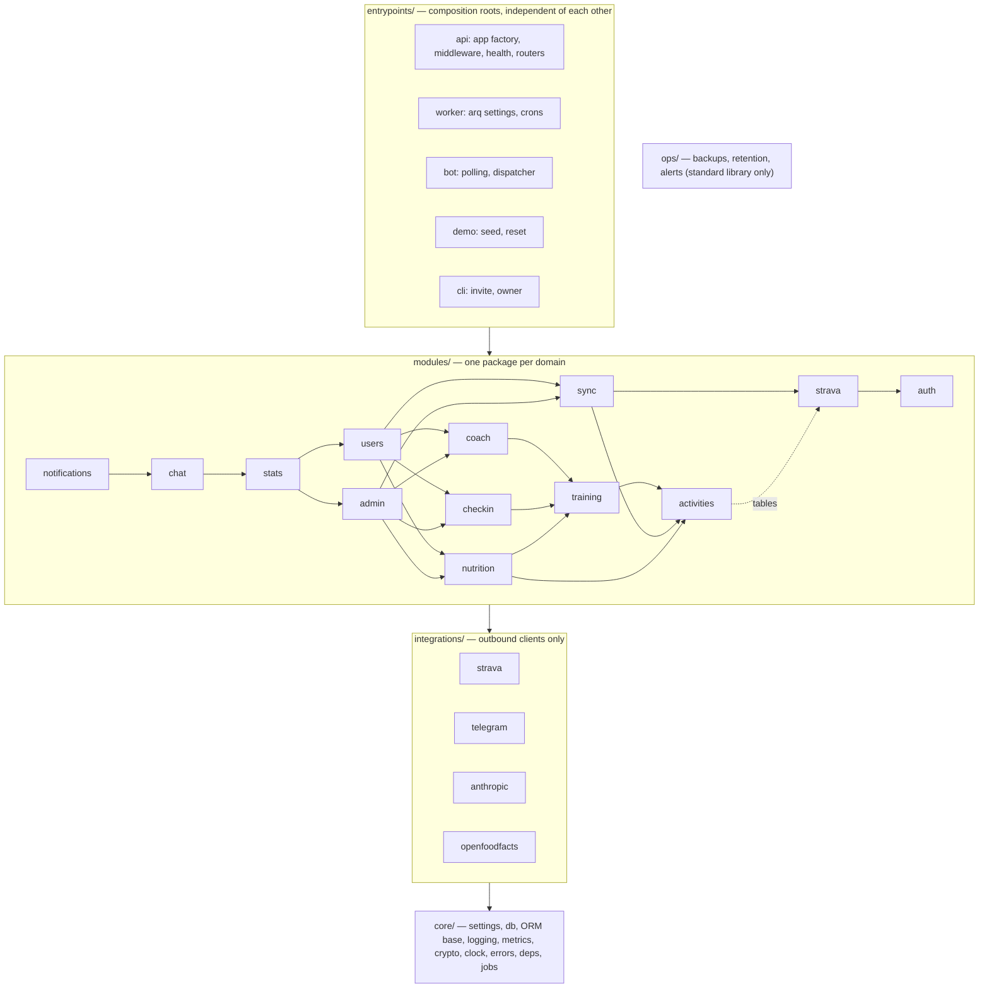

# Architecture

## Purpose

Keep a complete, always-fresh copy of my Strava activities in my own PostgreSQL database
and expose it through my own API (filters, weekly stats), without depending on Strava
being up or my rate-limit budget being available at read time. Since Phase 8 the same
deployment serves several invite-only accounts, each with its own data, Strava athlete,
Telegram chat and settings (ADR 0034–0037), and progress statistics compare each user's
periods with the ones before, in their own time zone (ADR 0038).

## Components

```
                ┌─────────────────────────── trainsync ───────────────────────────┐
 Strava  ──webhook POST──▶  API (FastAPI)  ──enqueue──▶  Redis (arq queue)        │
   ▲                         │   ▲                           │                    │
   │                         │   └── read API ◀── PostgreSQL ◀── upsert ──┐       │
   │                         │                                           │       │
   └──── HTTPS (httpx) ◀── Strava client ◀── Worker (arq jobs + cron) ───┘       │
          rate limiter · retries · circuit breaker · token refresh               │
                └────────────────────────────────────────────────────────────────┘
```

- **API process**: accounts and sessions (`/v1/auth`, `/v1/me`, owner-only `/v1/admin`), OAuth
  endpoints, webhook endpoints, read API, health, metrics.
- **Worker process**: backfill, incremental sync, webhook event processing, scheduled jobs
  (including the evening check-in prompt and the Monday / 1st-of-month progress digests, per user
  in each user's time zone), account purge.
- **Strava client**: the only place that talks to Strava. Owns auth headers, token refresh,
  retries, rate-limit accounting and the circuit breaker.
- **Bot process** (`python -m trainsync.entrypoints.bot`, Phase 5): Telegram long polling, deterministic
  summary commands, training/nutrition commands and the daily check-in (Phase 6). A chat is
  linked to an account with `/link CODE`; the bot calls the read API with its service key and
  `X-Acting-User: <linked user>` (ADR 0036), never the database (ADR 0012, ADR 0013). Optional natural-language questions: Claude chooses read-API
  calls through four validated tools, every number comes from the API (ADR 0014). All wording
  (replies, notifications, the assistant's persona) comes from a message pack chosen by
  `BOT_TONE` × `BOT_LANG` (ADR 0016); since Phase 8 these are defaults that each user's
  `user_settings` override. `BOT_INTENSITY=savage` adds the owner's opt-in brutal
  coach (savage line pack, excuse roasts, timed messages from the worker), and hard guardrails
  (body, slurs, pain/illness, distress, food restriction) hold in every intensity (ADR 0030). `BOT_LANG` is the
  default; `/lang` stores the linked user's language, which the bot and the worker follow (ADR 0031).
  Savage also roasts unhealthy choices (chat mentions, high-sugar or NOVA 4 `/eat` logs) with one
  concrete move, and `BOT_PROFANITY` / `/swear` (per user) decides whether only the roasts or
  every savage message swears (ADR 0032).
- **Web dashboard** (`web/`, Next.js): server-side BFF that signs the user in against the API
  (email + password), keeps the API session token sealed in an httpOnly AES-256-GCM cookie
  (`DASHBOARD_SESSION_SECRET`) and forwards allowlisted method + path combinations with it as
  `Authorization: Bearer` (reads, the account under `/v1/me`, owner-only `/v1/admin`, and
  CSRF-checked JSON writes to training, nutrition and check-ins). It holds no API key (ADR 0011,
  ADR 0034). Phase 6 pages:
  `/training` (today, programs, the active-workout screen, history, progress) and `/nutrition`;
  installable as a PWA without a service worker (ADR 0021).
- **fake_strava**: a small FastAPI app that mimics the endpoints we use, with configurable
  latency, error rate and rate-limit headers. Used for local dev, integration tests and load tests.

## Code layout

A modular monolith in four layers (ADR 0033). Imports only point down; import-linter checks it
in `make lint`, so CI fails on a wrong-way import.



| Folder | Holds | May import |
|---|---|---|
| `core/` | settings, DB engine/session (`db.py`), ORM base (`orm.py`), logging, metrics, crypto, signed state, clock, OpenAPI error docs, FastAPI deps, job queue, shared httpx client | nothing above it |
| `integrations/strava/` | HTTP client, rate limiter, retries, circuit breaker, rate budget | `core` |
| `integrations/telegram/` | Bot API client, Telegram notifier | `core`, `integrations` |
| `integrations/anthropic/` | the Messages API call, the assistant's tool definitions | — |
| `integrations/openfoodfacts/` | product lookup | `core` |
| `modules/auth/` | users, sessions, invites, password resets: argon2id hashing, login limits (Redis), `CurrentUser` dependency (Bearer / API key / service key + `X-Acting-User`), `/v1/auth` | `core` |
| `modules/strava/` | OAuth routes bound to the signed-in user, athletes, encrypted tokens, `TokenManager`, `/v1/me/strava` | `auth`, `core`, `integrations` |
| `modules/activities/` | activity upserts, reads, `/v1/activities` | `strava` tables |
| `modules/sync/` | backfill, incremental, webhook intake/processing/retry, deauthorization, `/v1/sync/status` | `activities`, `strava` |
| `modules/training/` | exercises, programs, workouts, sets, generator, progression, plates, `/v1/training` | `activities` |
| `modules/checkin/` | daily check-ins, streaks, `/v1/checkins` | `training` |
| `modules/nutrition/` | foods, logs, energy balance, free sugar, `/v1/nutrition` | `training`, `activities` |
| `modules/coach/` | voice, intensity, guardrails, savage lines, schedule, message packs (`packs/`) | `training` |
| `modules/users/` | `/v1/me`: profile, password, sessions, per-user settings (`user_settings`), export, deletion and the `purge_user` job | every module below it |
| `modules/admin/` | owner-only `/v1/admin`: invites, account list, reset links | every module below it |
| `modules/stats/` | `/v1/stats`: weekly totals and progress statistics (periods, endurance, strength, adherence, consistency, food, body, series, heatmap, PRs), the versioned cache and `user_data_versions` (ADR 0038) | every module below it (reads check-ins, nutrition rules, user settings) |
| `modules/chat/` | the Telegram conversation over the read API: command features, parsing, formatting, assistant loop (daily limit per user), chat links (`telegram_chats`), `/v1/me/telegram` and the service-key-only `/v1/telegram/chats` | every module below it |
| `modules/notifications/` | worker senders: new activity, check-in, coach, progress digests, stack alerts | everything below it |
| `entrypoints/` | `api/app.py`, `worker/settings.py`, `bot/main.py`, `demo/`, `cli/` (owner tools: `invite`, `owner`) | everything |
| `ops/` | backup CLI, retention, alert delivery | standard library only |

Every module may import any module's `models.py` (tables are shared; `modules/models.py`
imports them all for the metadata). Web (`web/src`): `app/` routes only, `features/<domain>/`
(components, API calls, types), `lib/` (BFF client, generated API types, session, CSRF,
config, formatting), `components/ui/`, `styles/`; ESLint keeps `lib/` and `components/ui/` from
importing features or routes, and features from importing routes.

## Data model

Tenancy (Phase 8, ADR 0035): every user-owned table has `user_id bigint NOT NULL REFERENCES
users ON DELETE CASCADE` and an index led by it; repositories take the user id in their
constructor and add it to every statement, and not-yours answers 404 like missing. Uniqueness is
per user (`(user_id, client_id)`, `(user_id, date)`, one active program and one nutrition profile
per user). Shared rows have `user_id NULL`: built-in exercises and the food catalogue / Open Food
Facts cache; custom exercises and manual foods carry their owner's id and only the owner sees them.
`webhook_events` has no user (it is routed through the athlete). Migrations 0015–0017 turn a
single-user database into this one and give every existing row to `OWNER_EMAIL`.

Accounts (Phase 8, ADR 0034, ADR 0036):

| Table | Key columns | Notes |
|---|---|---|
| `users` | `id`, `email` (unique, lower-cased), `password_hash` (argon2id), `display_name`, `role` (`owner` / `user`), `timezone` (IANA), `created_at`, `deleted_at` | partial unique index: exactly one owner; `deleted_at` set → purge pending |
| `sessions` | `id`, `user_id`, `token_hash` (SHA-256, unique), `user_agent`, `created_at`, `last_seen_at`, `expires_at`, `revoked_at` | expiry slides by `SESSION_TTL_DAYS` on use, capped at `SESSION_MAX_AGE_DAYS` from `created_at` |
| `invites` | `id`, `code_hash` (unique), `note`, `created_by`, `created_at`, `expires_at`, `used_at`, `used_by`, `revoked_at` | single use, `INVITE_TTL_DAYS` |
| `password_resets` | `id`, `user_id`, `token_hash` (unique), `created_at`, `expires_at`, `used_at` | owner-generated links, `RESET_TTL_MINUTES` |
| `user_settings` | `user_id` (PK), `tone`, `intensity`, `profanity`, `lang`, `checkin_enabled`, `checkin_time`, `checkin_reminder_minutes`, `quiet_hours`, `workout_reminder_time`, `sugar_limit_g`, `country`, `stats_digest_enabled`, `updated_at` | NULL = the environment default (`BOT_TONE`, `CHECKIN_TIME`, `STATS_DIGEST_ENABLED`, …); `country` picks the emergency number; replaces `chat_settings` |
| `user_data_versions` | `user_id` (PK, FK cascade), `version` (bigint) | one row per user, created by a trigger on `users`; bumped by the `bump_user_data_version` row trigger on every table in `stats/models.py` `VERSIONED_TABLES` (activities, training, food, body, check-ins; migration 0018); the statistics cache key (ADR 0038) |
| `telegram_chats` | `chat_id` (PK), `user_id` (unique), `linked_at` | one chat per user; `/link CODE` writes it, the code itself lives in Redis |

Strava and sync:

| Table | Key columns | Notes |
|---|---|---|
| `athletes` | `id`, `user_id` (unique), `strava_athlete_id` (unique), `active`, `created_at` | one athlete per user and one user per athlete (ADR 0037); `active=false` after deauthorization or disconnect |
| `oauth_tokens` | `athlete_id` (PK/FK), `user_id`, `access_token_enc`, `refresh_token_enc`, `expires_at`, `scope` | encrypted with Fernet |
| `activities` | `id`, `user_id`, `strava_activity_id` (unique), `athlete_id`, `name`, `sport_type`, `start_date` (timestamptz), `distance_m`, `moving_time_s`, `elapsed_time_s`, `elevation_gain_m`, `average_heartrate` (nullable), `raw` (jsonb), `deleted_at` (nullable), `synced_at` | upsert on `strava_activity_id`; soft delete |
| `sync_runs` | `id`, `user_id`, `athlete_id`, `kind` (backfill / incremental), `status`, `cursor` (jsonb), `pages`, `upserted`, `error`, `started_at`, `updated_at`, `finished_at` | `cursor` makes backfill resumable; `updated_at` is a per-page heartbeat |
| `webhook_events` | `id`, `dedup_key` (unique), `payload` (jsonb), `status`, `attempts`, `received_at`, `last_attempt_at`, `processed_at` | dedup on (subscription_id, object_type, object_id, aspect_type, event_time) |
| `notifications` | `id`, `user_id`, `kind` (`new_activity`, `checkin_prompt`, `checkin_reminder`, `coach_*`, `stats_digest_week`, `stats_digest_month`), `object_id`, `sent_at`; unique (`user_id`, `kind`, `object_id`) | claimed before sending, released on a failed send (ADR 0012); check-in kinds use the local date `yyyymmdd` as `object_id` (ADR 0020), digests the first day of the period |

Indexes: `activities (athlete_id, start_date desc)`, `activities (athlete_id, sport_type, start_date)`,
`activities (user_id, start_date desc)`, `webhook_events (status, received_at)`.

Training (Phase 6, per user since Phase 8, no `athlete_id`; every table below has `user_id`):

| Table | Key columns | Notes |
|---|---|---|
| `exercises` | `id`, `user_id` (NULL = built-in), `slug` (unique among built-ins, and per user), `name`, `primary_muscle`, `secondary_muscles` (text[]), `equipment`, `movement_pattern` (nullable), `is_custom`, `created_at` | ~70 built-in rows seeded by migration 0005 from `training/seed_exercises.json`; `movement_pattern` feeds the program generator |
| `programs` | `id`, `name`, `goal` (strength / hypertrophy / general), `days_per_week`, `weeks`, `active`, `created_at` | partial unique index: at most one active program per user |
| `program_days` | `id`, `program_id` (FK cascade), `day_index`, `name`, `weekday` (0–6, nullable), `start_time` (nullable); unique (`program_id`, `day_index`) | `weekday`/`start_time` drive the coach's reminders; null = default spread and `WORKOUT_REMINDER_TIME` (ADR 0030) |
| `program_exercises` | `id`, `program_day_id` (FK cascade), `exercise_id`, `position`, `sets`, `rep_min`, `rep_max`, `rest_seconds`, `start_weight_kg`, `progression` | |
| `workouts` | `id`, `client_id` (uuid, unique per user), `program_day_id` (nullable, set null), `started_at`, `ended_at`, `notes`, `strava_activity_id` (link, no FK) | started with `PUT` by `client_id`: a retried start is one workout (ADR 0017) |
| `workout_sets` | `id`, `client_id` (uuid, unique per user), `workout_id` (FK cascade), `exercise_id`, `set_index`, `reps`, `weight_kg` numeric(6,2), `rpe`, `is_warmup`, `completed_at`, `rest_seconds` | upsert on `client_id`: a retried log is one row |
| `body_metrics` | (`user_id`, `date`) PK, `weight_kg` | only what the user enters |
| `daily_checkins` | `id`, `date` (unique per user, local day), `status` (done / partial / skipped / rest / sick_or_injured), `workout_id` (nullable, set null), `reason_note`, `sleep_hours`, `energy_1_5`, `body_weight_kg`, `created_at`, `updated_at` | upsert on (`user_id`, `date`); a body weight is also written to `body_metrics` (P6.9, ADR 0020) |

Index `workout_sets (user_id, completed_at)` (migration 0018) serves the statistics' set ranges.

Training math (`training/math.py`): volume = reps × weight without warm-ups; Epley e1RM for 1–12
reps (none above); records per exercise for weight at a rep count, e1RM and session volume. The
progress statistics use sets of at most `STATS_E1RM_MAX_REPS` (10) for their e1RM trend and PRs
(ADR 0038).

Nutrition (Phase 6, P6.4, per user since Phase 8, no `athlete_id`; ADR 0019):

| Table | Key columns | Notes |
|---|---|---|
| `foods` | `id`, `user_id` (NULL = shared catalogue / Open Food Facts cache), `name`, `brand`, `barcode` (unique among shared rows, and per user; nullable), `kcal_100g` numeric(6,1), `protein_100g` / `carbs_100g` / `fat_100g` (numeric(5,1), nullable = unknown), `source` (manual / openfoodfacts), `created_at` | Open Food Facts results are cached here as shared rows, upserted on `barcode`; a shared row the owner edits turns `manual`, so later lookups leave it alone; a user sees the shared rows plus their own |
| `food_favorites` | (`user_id`, `food_id`) PK | a user's favourites, shared or own foods (replaces `foods.favorite`) |
| `food_logs` | `id`, `user_id`, `client_id` (uuid, unique per user), `date`, `meal` (breakfast / lunch / dinner / snack), `food_id` (FK), `grams` numeric(6,1), `kcal_100g`, `protein_100g`, `carbs_100g`, `fat_100g` (snapshot of the food at log time), `created_at` | upsert on `client_id`: a retried log is one row; summaries read the snapshot, so editing a food never changes past days; index (`user_id`, `date`, `meal`) |
| `nutrition_profile` | `user_id` (PK), `sex`, `birth_year`, `height_cm`, `activity_baseline` (sedentary / light / moderate), `kcal_target`, `protein_target_g`, `updated_at` | one row per user; body weight is not here, it comes from `body_metrics` |

Energy balance (`nutrition/energy.py`, pure, all values are estimates; `nutrition/summary.py` reads
the tables):
- **Days are UTC days**, like the rest of the read API: an activity counts on the UTC date of its
  `start_date`; a food log on the `date` the client sent.
- **BMR**: Mifflin–St Jeor (`10w + 6.25h − 5a + 5`, female `− 161`), `w` = latest `body_metrics`
  weight on or before the day, `a` = day's year − birth year. No profile or no weight → BMR,
  baseline, expenditure and balance are null and `estimate_unavailable_reason` says why
  (`no_profile` / `no_body_weight`). Nothing is guessed.
- **Baseline** = BMR × 1.2 / 1.375 / 1.55 (everyday activity, logged exercise excluded).
- **Exercise** per activity of active athletes, soft-deleted excluded: `raw.calories` when > 0, else
  for `sport_type` containing `Ride` `raw.kilojoules` (≈ kcal), else unknown (`kcal: null`,
  `kcal_known: false`). Known values are summed into `exercise_kcal`; unknowns are counted
  (`exercise_unknown_count`, `exercise_complete`).
- **Balance** = intake − (baseline + known exercise); `balance_complete` is false when an activity's
  energy is unknown or there is no baseline. kcal and grams are rounded to 0.1 at the end.
- A `kcal_target` below the estimated BMR is stored as entered and the profile answers with a
  neutral `warning`; the API never suggests a deficit.

Endpoints (`/v1/nutrition`, signed in, per user): `GET/POST /foods`, `GET /foods/lookup?barcode=|q=`,
`PATCH /foods/{id}`, `PUT/DELETE /foods/{id}/favorite`, `GET /log?date=`,
`PUT/DELETE /log/{client_id}` (PUT → 201 created / 200 updated), `GET/PUT /profile`,
`GET /summary?date=`, `GET /summary/weekly?from=&to=` (default: current ISO week, ≤ 92 days).

Open Food Facts (`nutrition/off_client.py`, the only module that calls it): public API, no key,
`OPENFOODFACTS_USER_AGENT`, the process's shared `httpx.AsyncClient` with a 3 s whole-request
timeout, no retries. Timeouts, network errors and non-200/404 answers → the lookup still answers
with local matches and `remote: "unavailable"`; `OPENFOODFACTS_ENABLED=false` → `remote: "disabled"`.
The remote call happens outside any DB session, so a slow lookup never holds a connection.

## Flows

### 0. Accounts and authentication (Phase 8, ADR 0034, ADR 0036)
- **Register**: `POST /v1/auth/register` (email, password 10–128 characters, optional display
  name and IANA time zone, `invite_code` when `REGISTRATION_MODE=invite`); `open` needs no code,
  `closed` refuses. `GET /v1/auth/registration` tells the client which mode is on.
- **Login**: `POST /v1/auth/login` → a random 32-byte token, returned once; only its SHA-256 is
  stored in `sessions`. Errors are one generic message; unknown emails are checked against a
  dummy hash so timing does not reveal them. Limits in Redis (fixed windows, injected clock):
  `LOGIN_MAX_FAILURES` per email per `LOGIN_LOCKOUT_MINUTES` (then locked, right password or
  not), `LOGIN_MAX_FAILURES_PER_IP`, `REGISTER_MAX_PER_HOUR`. The gateway adds 30/min per IP on
  `/v1/auth/*`.
- **Logout / revoke**: `POST /v1/auth/logout`, `DELETE /v1/me/sessions/{id}`; a password change
  (`POST /v1/me/password`) revokes every other session; a reset (`POST /v1/auth/reset` with an
  owner-made token) and account deletion revoke all.
- **Three ways to call `/v1`**, resolved by the `CurrentUser` dependency (`modules/auth/dependencies.py`):

  | Caller | Headers | Acts as |
  |---|---|---|
  | a person (web BFF, any client) | `Authorization: Bearer <session token>` | the session's user |
  | owner tooling (scripts, curl, monitors) | `X-API-Key: <one of API_KEYS>` | the owner |
  | the Telegram bot | `X-API-Key: <one of SERVICE_API_KEYS>` + `X-Acting-User: <user id>` | that user; without the header, the owner |

  `X-Acting-User` from any other key is refused. The public gateway strips the header
  (`deploy/gateway/routes.toml` via `scripts/render_gateway.py`), so it only works from inside
  the stack; `make prod-check` proves it. `/v1/admin/*` needs the owner (403 otherwise);
  `/v1/telegram/chats/*` needs a service key.

### 1. OAuth connect
1. `GET /auth/strava/login` (or `POST /v1/me/strava/authorize-url`, which the BFF uses) needs a
   signed-in caller and redirects to Strava's authorize URL with `scope=read,activity:read_all`
   and a signed `state` that carries the user id (ADR 0037).
2. `GET /auth/strava/callback` verifies `state`, exchanges `code` for tokens, upserts athlete +
   encrypted tokens bound to that user. An athlete already bound to another user → 409, nothing
   written; a user has at most one active athlete.
3. Enqueues a `backfill` job. `DELETE /v1/me/strava` deactivates the athlete at once; a worker job
   then deauthorizes at Strava and deletes its tokens and activities.
4. Optional `return_to` on step 1 (exact match against `OAUTH_RETURN_TO_ALLOWLIST`) is signed into
   `state`; the callback then sends the browser back there with a 303 (ADR 0015).

### 2. Token refresh
- Before each Strava call: if `expires_at - 5 min < now`, refresh.
- On a 401: refresh once, retry once, then fail.
- Refresh is guarded by a per-athlete Redis lock, because concurrent jobs refreshing at the same
  time would race and one of them could end up storing a stale refresh token.
- Always persist the refresh token returned by Strava (it can change).

### 3. Strava client: retries, rate limits, circuit breaker
- **Timeouts**: connect 3 s, read 10 s, pool 5 s.
- **Retries**: only for network errors, timeouts, 5xx and 429. Exponential backoff with full jitter,
  max 4 attempts. Never retry other 4xx.
- **Rate limits**: Strava returns `X-RateLimit-Limit` and `X-RateLimit-Usage` as `"<15min>,<daily>"`.
  Parse them on every response and store the latest values in Redis. Do not hard-code the limits.
  - Above 80% of the 15-minute budget, low-priority work (backfill) pauses until the next window;
    webhook-driven fetches keep going. This is a two-priority budget.
  - On 429, wait until the next 15-minute window boundary (check Strava docs for reset rules)
    instead of hammering with retries.
- **Circuit breaker** (per process): opens after N consecutive 5xx / timeouts, half-opens after a
  cooldown and lets one probe request through. While open, jobs are re-queued with a delay
  instead of failing. 4xx and 429 mean Strava answered, so they count as successes. A sync job
  that gets `StravaUnavailable` while the circuit is still closed is also paused and deferred
  (30 s) instead of failed. See ADR 0005.
- Metrics for every call: endpoint, status, duration, retry count.

### 4. Backfill
- Paginate `GET /athlete/activities?per_page=200&page=N` (or `before=` timestamp cursor).
- Upsert each page in one transaction, then persist the cursor in `sync_runs.cursor`.
- If the worker dies or the rate budget runs out, the next run resumes from the cursor.
- Cursor = oldest `start_date` on the page + 1 s (always `page=1`), so activities sharing the
  boundary second are re-fetched instead of skipped; the history is done on an empty page or when
  a short page makes no progress.
- One backfill per athlete: arq job id `backfill:{athlete_id}`, and a `running` run whose
  `updated_at` heartbeat is younger than 5 minutes is left alone (older = its worker died → resume).
- Fair scheduling (Phase 8, ADR 0037): a job stops after `BACKFILL_PAGES_PER_JOB` pages, keeps
  its cursor and re-enqueues itself with a short defer, so several athletes' backfills interleave;
  incremental syncs and webhook fetches keep their higher priority in the shared budget.

### 5. Incremental sync (cron, every 30 min)
- `after = max(start_date) - 2 days` overlap window to catch late edits and uploads.
- Same upsert path as backfill. Safety net for missed webhooks.

### 6. Webhooks
- `GET /webhooks/strava`: subscription validation. Check `hub.verify_token`,
  respond `{"hub.challenge": "<value>"}` with 200.
- `POST /webhooks/strava`: must return 200 within 2 seconds (Strava retries up to 3 times otherwise).
  - Validate `subscription_id`.
  - `INSERT ... ON CONFLICT (dedup_key) DO NOTHING` into `webhook_events`.
  - Enqueue `process_webhook_event(event_id)` and return 200 immediately.
- Worker processing (the event's `owner_id` → athlete → user; rows are written for that user only):
  - `activity create/update` → fetch `GET /activities/{id}` and upsert. Use the fetched data,
    not the event, so out-of-order events end in the correct final state.
  - `activity delete` → soft delete.
  - `athlete update` with `authorized=false` → mark athlete inactive, delete tokens and the
    athlete's activities.
- Failed events stay in `webhook_events` with `status=failed` and `attempts`. A cron job retries them
  with backoff. This acts as a simple dead-letter table. The same cron (every 5 min) re-enqueues
  `pending` events older than 10 minutes that have no live job, and releases events stuck in
  `processing` for over 10 minutes. After 8 attempts an event is a dead letter (ADR 0008).

### 6b. New-activity notifications (Phase 5)
- After a live `activity create` event is upserted, webhook processing enqueues
  `notify_new_activity(strava_activity_id)` with job id `notify:{id}`. Backfill and incremental
  sync never do: history is not news.
- The job claims `(new_activity, id)` in `notifications` (`ON CONFLICT DO NOTHING`), commits, then
  sends through the `Notifier` (Telegram, or the `NullNotifier` without a token). A definite
  failure releases the claim and arq retries with backoff (10 s, 30 s, 90 s, 270 s; 5 tries).
  A timeout after the request went out keeps the claim: at most one message per activity.

### 7. Read API (any of the three auth modes in flow 0; every read is scoped to the caller's user)
- `GET /v1/activities?from=&to=&sport_type=&limit=&cursor=`: keyset pagination on `(start_date, id)`.
- `GET /v1/activities/{strava_activity_id}`: one activity; 404 if unknown or soft-deleted.
- `GET /v1/stats/weekly?from=&to=&sport_type=`: per ISO week (Monday start, the user's time zone)
  distance, moving time, elevation, count (SQL aggregation).
- `GET /v1/stats/summary?period=&from=&to=&sport_type=`: totals for the range, the same totals per
  `sport_type`, and the longest activity (greatest distance), plus the progress blocks of flow 7e.
  One SQL query per block.
- `GET /v1/stats/series`, `/heatmap`, `/prs`: flow 7e.
- `GET /v1/sync/status`: last sync runs, last webhook, webhook retry and dead-letter counts, current
  rate-limit usage, circuit state of every process (each publishes its breaker transitions to Redis).
- Responses include `last_synced_at`, so the client knows how fresh the data is when Strava is degraded.
- `GET/PATCH /v1/me/settings`: the user's settings (`user_settings`, null = the environment
  default), written by the dashboard and the bot's `/lang` and `/swear`, read by the bot (cached
  `BOT_CHAT_CACHE_S`) and the worker at send time (ADR 0031, ADR 0036).
- `GET /v1/me/export`: one JSON document with every row the user owns (no Strava tokens);
  `DELETE /v1/me` (password): soft delete, sessions revoked and Telegram unlinked at once, then
  the `purge_user` job deauthorizes Strava and deletes the user's rows (ADR 0037). The owner
  account cannot be deleted.
- Telegram linking (ADR 0036): `POST /v1/me/telegram/code` issues an 8-character code in Redis
  (`TELEGRAM_LINK_CODE_TTL_MINUTES`, deleted on use); the bot redeems it with
  `POST /v1/telegram/chats/{chat_id}/link`, looks chats up with `GET /v1/telegram/chats/{chat_id}`
  (user id + settings) and unlinks with `DELETE` (service key only). `DELETE /v1/me/telegram`
  unlinks from the dashboard.

### 7b. Training API (Phase 6, `/v1/training`, signed in, per user)
Routers in `api/training/`; every number (volume, e1RM, records, weekly muscle volume) comes from
`training/math.py`. Weights are exact decimals in requests (0–500 kg in 0.25 steps; reps 0–100;
RPE 1–10 in 0.5 steps) and JSON numbers in responses.
- Exercises: `GET /exercises?q=&muscle=&equipment=`; custom ones via `POST /exercises` and
  `PATCH /exercises/{id}` (built-ins are read-only, `409`).
- Programs: CRUD under `/programs`, `GET /programs/active`, `POST /programs/{id}/activate`
  (one active at a time).
- Workouts: `PUT /workouts/{client_id}` (idempotent start, free or `program_day_id`),
  `GET /workouts` (keyset on `(started_at, id)`, ADR 0009), `GET /workouts/{id}`,
  `POST /workouts/{id}/finish`, `DELETE`.
  Start, get and finish return one shape: summary (`volume_kg`, `set_count`), `planned` (the day's
  exercises with `last_performance`), `sets` and `records` (PRs the sets beat against all earlier
  workouts).
- Sets: `PUT /workouts/{id}/sets/{client_id}` upserts by a client-generated UUID (`201` first,
  `200` on a repeat, `409` when the id belongs to another workout); `DELETE` is idempotent (ADR 0017).
- Progress: `GET /exercises/{id}/progress` (best set, e1RM and volume per workout),
  `GET /volume/weekly` (working sets and kg per ISO week and primary muscle), `GET /prs` (standing
  records, found by replaying workouts oldest first through `detect_prs`).
- Body metrics: `PUT /body-metrics/{date}`, `GET /body-metrics?from=&to=`.
- Planning (ADR 0018, all pure functions in `training/`): `POST /programs/generate` returns a
  deterministic rule-based preview (`generator.py`), and its `program` field is the body to `POST
  /programs` to save it. Each `planned` exercise of a workout has a `suggestion` from double
  progression (`progression.py`: `start` / `increase` / `hold` / `deload`, with `weight_kg`).
  `GET /plates?target=` gives the plates per side (`plates.py`), using `GYM_BAR_KG` and
  `GYM_PLATES`.
- Next day (P6.8): `GET /programs/active/next-day` is the active program's day that is up, in
  rotation: the day after the one the latest workout followed (wrapping around), the first day
  without history, or the day of a still-open workout (`open_workout_id`). Planned exercises come
  with their `suggestion`, so `/today` in the bot shows suggested weights without starting a workout.

### 7c. Bot: training and nutrition commands (Phase 6, P6.8)
The bot stays an API client (read and write, its service key acting as the linked user). Commands live in `Feature` groups
(`modules/chat/training.py`, `modules/chat/nutrition.py`, `modules/chat/checkin.py`) that the dispatcher asks in turn:
- `/today` (next program day with suggested weights), `/plates 102.5`, `/log bench 80x5x3`
  (also `80x5,5,4` and `bw x12x3`, one parser in `modules/chat/parsing.py` shared with the check-in),
  `/done` (finish, summary with volume and records), `/eat <food> <grams>`, `/kcal`, `/weight 78.4`.
- **Local day**: "today" is the linked user's day in their time zone (`users.timezone`; a new
  account defaults to `CHECKIN_TZ`, `Europe/Istanbul`), not UTC:
  `/log` adds to the open workout started on that day (or starts a free one), `/eat`, `/kcal` and
  `/weight` send that date explicitly. The meal is picked from the local hour.
- **Idempotency**: client ids are `uuid5` of `tg:{chat}:{update_id}:{n}` (`/log` set n) and
  `tg:{chat}:{update_id}:eat`. A redelivered update (the bot crashed before confirming it)
  rewrites the same rows; a set that already exists keeps its `set_index`.
- **Exercise names**: a small alias table (`bench`, `dl`, `ohp`, `rdl`, `pullup`, …), then
  `GET /exercises?q=` matched on slug/name, exact before prefix. Food names match stored foods
  (favourites first), falling back to the Open Food Facts lookup. More than one candidate → a
  numbered list; the choice waits in Redis (`bot:pending:{chat}`, 15 min) and a number answers it.
- **Wording**: training texts come from the tone packs; food, scale, sleep and energy texts come
  from a tone-free layer (`messages/neutral.py`, `NeutralKey`), identical in every `BOT_TONE`.

### 7d. Daily check-in (Phase 6, P6.9, ADR 0020)
- **API** (`/v1/checkins`, signed in, local days): `GET ?from=&to=` (default 12 weeks),
  `GET /{date}`, `PUT /{date}` (upsert by date: `201` / `200`), `GET /summary?from=&to=` (current
  and longest streak, adherence = planned days done / planned days per ISO week from the active
  program's `days_per_week`, minus sick/injured days; done + partial count as done).
- **Scheduler**: worker cron every 5 minutes (`modules/notifications/checkin.py`), for each user
  with a linked chat (`modules/notifications/recipients.py`). At or after the user's check-in
  time (default `CHECKIN_TIME`) in the user's time zone (the wall time of each local date,
  DST-safe) it sends the prompt once, only if that day has no check-in; one reminder
  `checkin_reminder_minutes` later, still unanswered. "Sent" is a claim in `notifications`
  (`user_id`, `checkin_prompt` / `checkin_reminder`, object id `yyyymmdd`), so restarts and
  overlapping ticks never send twice. Off without a bot token, for users without a linked chat,
  or with check-ins disabled (`CHECKIN_ENABLED=false`, or the user's setting).
- **Conversation** (`modules/chat/checkin.py`, state diagram 17): a state machine in Redis
  (`checkin:{chat}:{yyyymmdd}`, 6 h TTL). Status buttons → planned exercises one by one (As
  planned = planned sets × bottom of the rep range at the suggested weight, ±2.5 kg, Skip, or
  typed sets) or free `/log` lines without a program → reason (skipped) → scale, sleep, energy
  (each skippable) → summary with volume, records and streak, plus an Edit button. Works without
  an Anthropic key.
- **Idempotency**: sets use `uuid5("checkin:{date}:{exercise_id}:{set_index}")`, the check-in is
  a `PUT` by date; buttons carry a per-step `seq` (stale or double presses are answered politely
  and change nothing); a redelivered text answer is recognised by its `update_id`.
- **Web**: `/training/checkins` calendar heatmap and day editor; streak and adherence tiles on
  the dashboard (writes through the BFF's CSRF-checked `PUT`).

### 7e. Progress statistics (Phase 8, P8.10, P8.11, ADR 0038)
- **Periods** (`stats/periods.py`): `week`, `month`, `year` are calendar units to date, compared
  with the same number of days at the start of the unit before (a short month clamps);
  `last_week`, `last_month` are whole units compared with the unit before; `3m`, `6m`, `12m` end
  today, `custom` is `from`..`to`, both compared with the same number of days right before; `all`
  starts at the user's first data and has no previous period. Every number carries `change`
  (value − previous) and `change_pct` (null when the previous value is 0 or missing).
- **Local days in SQL**: a period is inclusive local dates in the user's zone; the bounds are the
  UTC instants of the local midnights (`zoneinfo`, DST-safe), so the `(user_id, …)` indexes serve
  the range, and rows are grouped by `date(timezone(:tz, start_date))`. Date columns (food logs,
  body metrics, check-ins) are already local. Sums, counts and e1RM maxima are computed in
  Postgres, one query per block; Python only shapes the result.
- **Blocks** of `GET /v1/stats/summary`: endurance per sport group (run, ride, walk, swim, other;
  time-weighted average heart rate, longest and fastest); strength (sessions, working sets, reps,
  tonnage, volume per muscle and exercise, best e1RM per lift, PR count, adherence to the active
  program); consistency (active days, training streak in ISO weeks, check-in streak in days,
  check-in rate); nutrition (average kcal vs target, macros, days over the sugar limit, logged
  days); body (weight first / last / change, 7-day moving average, rate per week;
  `body_fat_pct` null until Phase 9).
- **Series, heatmap, PRs**: `GET /v1/stats/series?metric=&period=&bucket=day|week|month&sport=`
  gives one zero-filled point per bucket (weight: the mean, null without entries; kcal with the
  target); the default bucket is day up to 31 days, week up to 183, month beyond.
  `GET /v1/stats/heatmap?year=` is one entry per local day (training minutes, sessions, check-in
  status). `GET /v1/stats/prs?period=&exercise_id=` lists e1RM records (strictly above every
  earlier set of the lift, window function over the whole history) with the value they beat.
- **Cache** (`stats/cache.py`): windows of `STATS_CACHE_MIN_DAYS` (180) or more are stored in
  Redis under `stats:<user>:<data version>:<view>:<hash of the parameters>` for
  `STATS_CACHE_TTL_S`. The data version is the user's row in `user_data_versions`, bumped by a
  row trigger on every table the statistics read, so any writer (API, bot, sync, demo seed,
  `psql`) invalidates it; a stale entry is never read again and expires on its TTL. Redis down →
  computed instead. `stats_cache_total{outcome=hit|miss|error}`.
- **Bot** (`modules/chat/progress.py`): `/stats [week|month|3m|6m|year|all]` (default `week`) reads
  `/v1/stats/summary` as the linked user and answers with the main numbers and their changes, then
  a verdict from the mean change of moving time, tonnage and active days: praise or a roast
  (savage categories `progress_up` / `progress_down`, `coach/savage_progress.py`), a calm recovery
  line when the period had sick / injured check-ins. Body weight is never in it. The older
  `/stats [4w|12w|52w] [sport]` keeps its totals and best week.
- **Digests** (`modules/notifications/digest.py`): worker cron every 5 minutes; on Monday from
  `STATS_DIGEST_TIME` in the user's zone it owes last week's summary, on the 1st last month's.
  Quiet hours hold it until they end (same local day); each digest is claimed once in
  `notifications` (`stats_digest_week` / `stats_digest_month`, object id = first day of the
  period) before it is built; an empty period is claimed and not sent. Off without a bot token,
  with `STATS_DIGEST_ENABLED=false`, or with the user's `stats_digest_enabled=false`.

### 8. Operations
- `GET /health/live` (process up), `GET /health/ready` (DB + Redis reachable).
- `GET /metrics` Prometheus endpoint on the API; each worker serves its own on
  `WORKER_METRICS_PORT` (default 9100). One registry per process, no multiprocess mode (ADR 0010).
- JSON logs with `request_id` (API) / `job_id`, `job_name`, `athlete_id` or `event_id` (worker)
  correlation.
- Public demo (P7.9, ADR 0028): `compose.demo.yml` runs the same image with `DEMO_MODE=true`.
  `DemoReadOnlyMiddleware` answers every non-GET request and `/auth/strava/*` with
  `403 This is a read-only demo.` (header `X-Trainsync-Demo: read-only`) before routing; the only
  writes it lets through are `POST /v1/auth/login` and `POST /v1/auth/logout`, so the web can sign
  in to the published demo account (`demo@trainsync.invalid` / `trainsync-demo`). The data
  is `trainsync.entrypoints.demo.seed` (synthetic, fixed RNG, twelve weeks before today, owned by
  the demo user), written by
  `python -m trainsync.entrypoints.demo reset` (wipe + seed in one transaction, DEMO_MODE only) on `up` and
  nightly by the demo worker (`trainsync.entrypoints.demo.worker`, reset cron only).

## Failure modes this design handles

| Failure | Behavior | Proven by (`make test-fault`) |
|---|---|---|
| Strava 5xx / timeouts | retries with backoff → circuit opens → jobs delayed, reads unaffected | [`tests/fault/test_strava_5xx_burst.py`](../tests/fault/test_strava_5xx_burst.py), [`tests/fault/test_strava_timeouts.py`](../tests/fault/test_strava_timeouts.py) |
| Rate limit near / exceeded | backfill pauses, webhooks still processed; 429 waits for window reset | [`tests/fault/test_rate_limit_burst.py`](../tests/fault/test_rate_limit_burst.py) |
| Worker crash mid-backfill | resumes from persisted cursor; upserts are idempotent | [`tests/fault/test_worker_restart.py`](../tests/fault/test_worker_restart.py) (real SIGKILL) |
| Duplicate webhook delivery | dedup key, `ON CONFLICT DO NOTHING` | [`tests/fault/test_duplicate_webhooks.py`](../tests/fault/test_duplicate_webhooks.py) |
| Out-of-order webhook events | worker always fetches the current activity state | [`tests/fault/test_out_of_order_webhooks.py`](../tests/fault/test_out_of_order_webhooks.py) |
| Missed webhooks | incremental sync with an overlap window | [`tests/fault/test_missed_webhooks.py`](../tests/fault/test_missed_webhooks.py) |
| Expired / rotated tokens | proactive refresh, 401 retry, per-athlete lock | [`tests/fault/test_token_rotation.py`](../tests/fault/test_token_rotation.py) |
| User revokes access | deauth event → tokens and data removed (also mid-backfill) | [`tests/fault/test_deauth_during_backfill.py`](../tests/fault/test_deauth_during_backfill.py) |
| Telegram down when a new activity arrives | notification claim released, job retried with backoff, exactly one message once Telegram is back | [`tests/fault/test_telegram_down.py`](../tests/fault/test_telegram_down.py) |
