# Diagrams

All diagrams are Mermaid, so GitHub renders them inline. They describe the design in
[architecture.md](architecture.md); keep them in sync when the code changes.

- [1. Component diagram](#1-component-diagram)
- [2. Deployment diagram (docker compose)](#2-deployment-diagram-docker-compose)
- [3. Data model (ER)](#3-data-model-er)
- [4. Class diagram — core modules](#4-class-diagram--core-modules)
- [5. Sequence — OAuth connect](#5-sequence--oauth-connect)
- [6. Sequence — token refresh with per-athlete lock](#6-sequence--token-refresh-with-per-athlete-lock)
- [7. Sequence — Strava call: retries, rate limit, breaker](#7-sequence--strava-call-retries-rate-limit-breaker)
- [8. Sequence — resumable backfill](#8-sequence--resumable-backfill)
- [9. Sequence — webhook ack-then-process](#9-sequence--webhook-ack-then-process)
- [10. Sequence — deauthorization](#10-sequence--deauthorization)
- [11. Sequence — dashboard request through the BFF](#11-sequence--dashboard-request-through-the-bff)
- [12. Sequence — new activity → notification](#12-sequence--new-activity--notification)
- [13. State — circuit breaker](#13-state--circuit-breaker)
- [14. State — webhook event](#14-state--webhook-event)
- [15. State — sync run](#15-state--sync-run)
- [16. Activity — rate-limit budget decision](#16-activity--rate-limit-budget-decision)

---

## 1. Component diagram

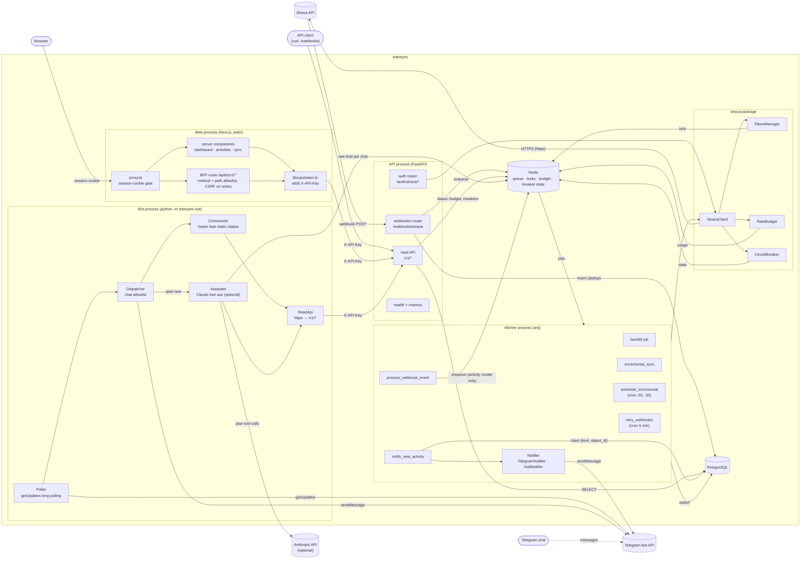

The web app and the bot are clients of the read API: neither touches PostgreSQL, and the API key
stays server-side (ADRs 0011, 0012). New-activity notifications run in the worker with its own
Telegram client, so they do not depend on the bot process.

## 2. Deployment diagram (docker compose)

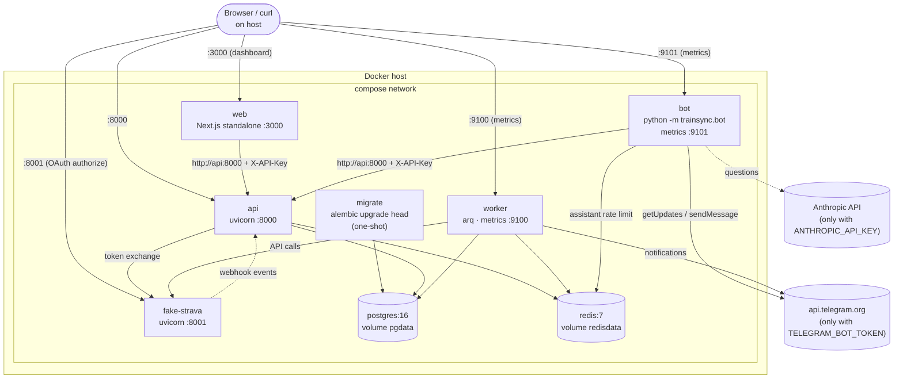

Without `TELEGRAM_BOT_TOKEN` the bot does not poll (it only serves its metrics and stays healthy)
and the worker uses the `NullNotifier`, so the stack and `make compose-smoke` behave the same with
or without a token.

## 3. Data model (ER)

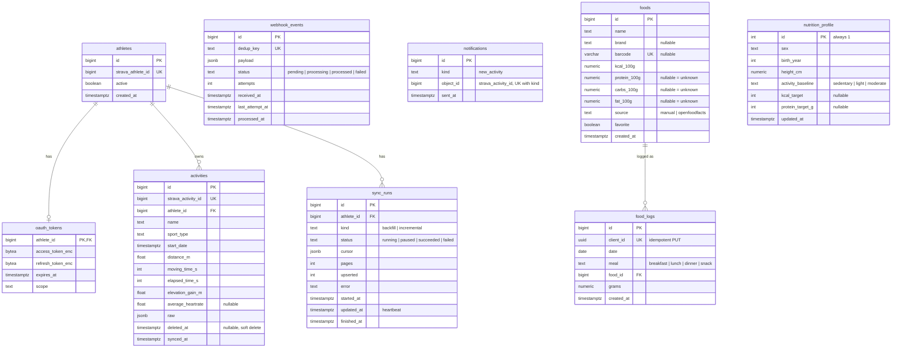

Nutrition (P6.4, ADR 0019) is single-user: no `athlete_id`. Body weight for the BMR estimate comes
from `body_metrics` (training), exercise energy from `activities.raw`.

`notifications` has no foreign key: a row is the idempotency claim for one message (ADR 0012),
kept even if the activity is deleted later.

### Training (Phase 6)

Single user, so no `athlete_id`. `workouts.strava_activity_id` is a link, not a foreign key.

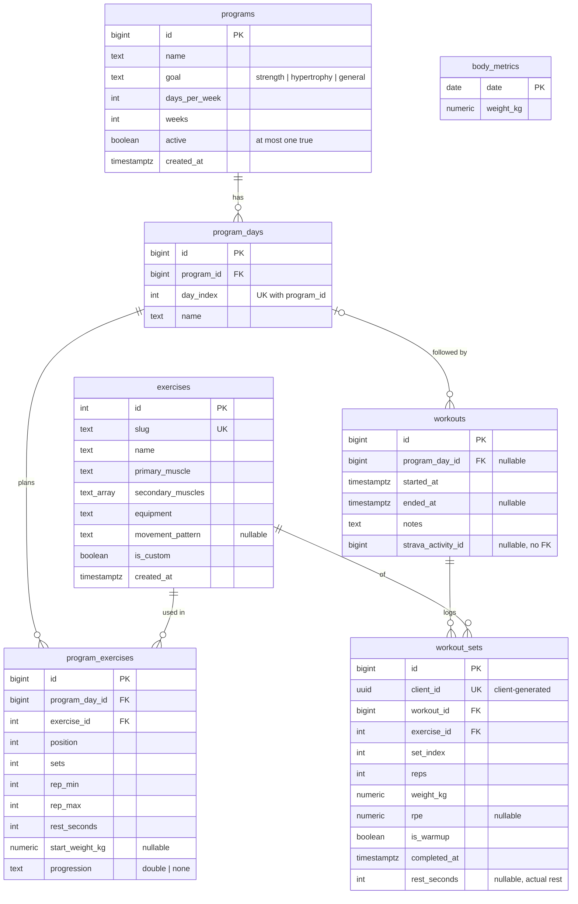

## 4. Class diagram — core modules

Generated from the code (public methods; Protocols shown as interfaces).


## 5. Sequence — OAuth connect

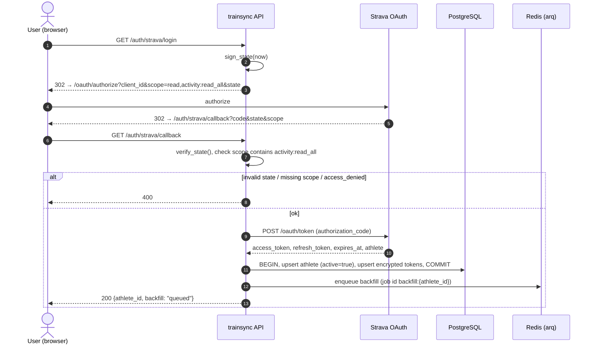

## 6. Sequence — token refresh with per-athlete lock

Two jobs need a token for the same athlete at the same moment, and the token is about to expire.

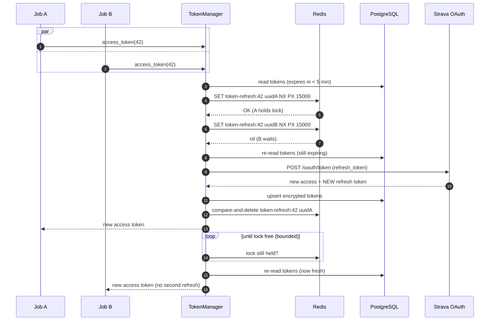

## 7. Sequence — Strava call: retries, rate limit, breaker

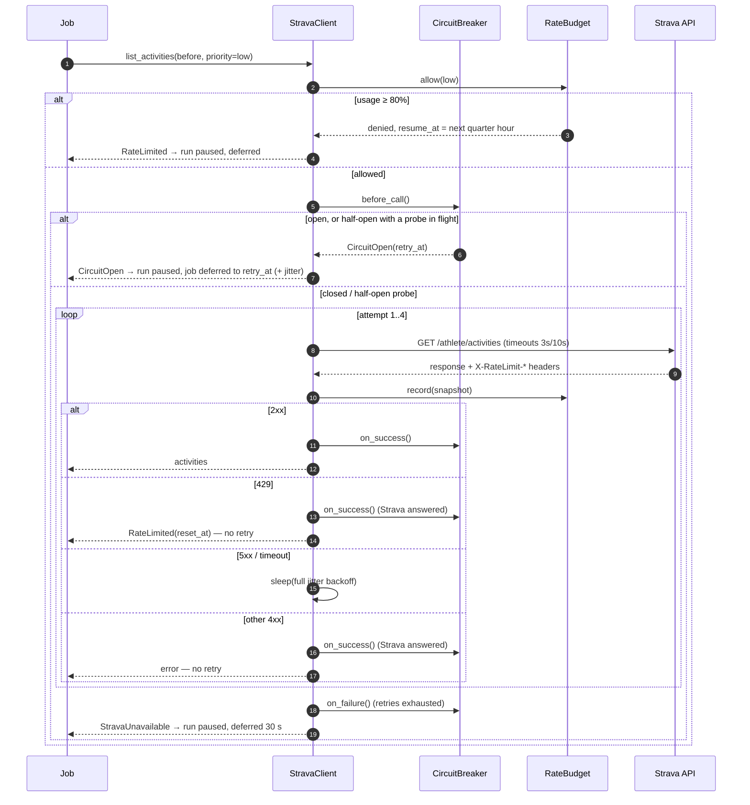

## 8. Sequence — resumable backfill

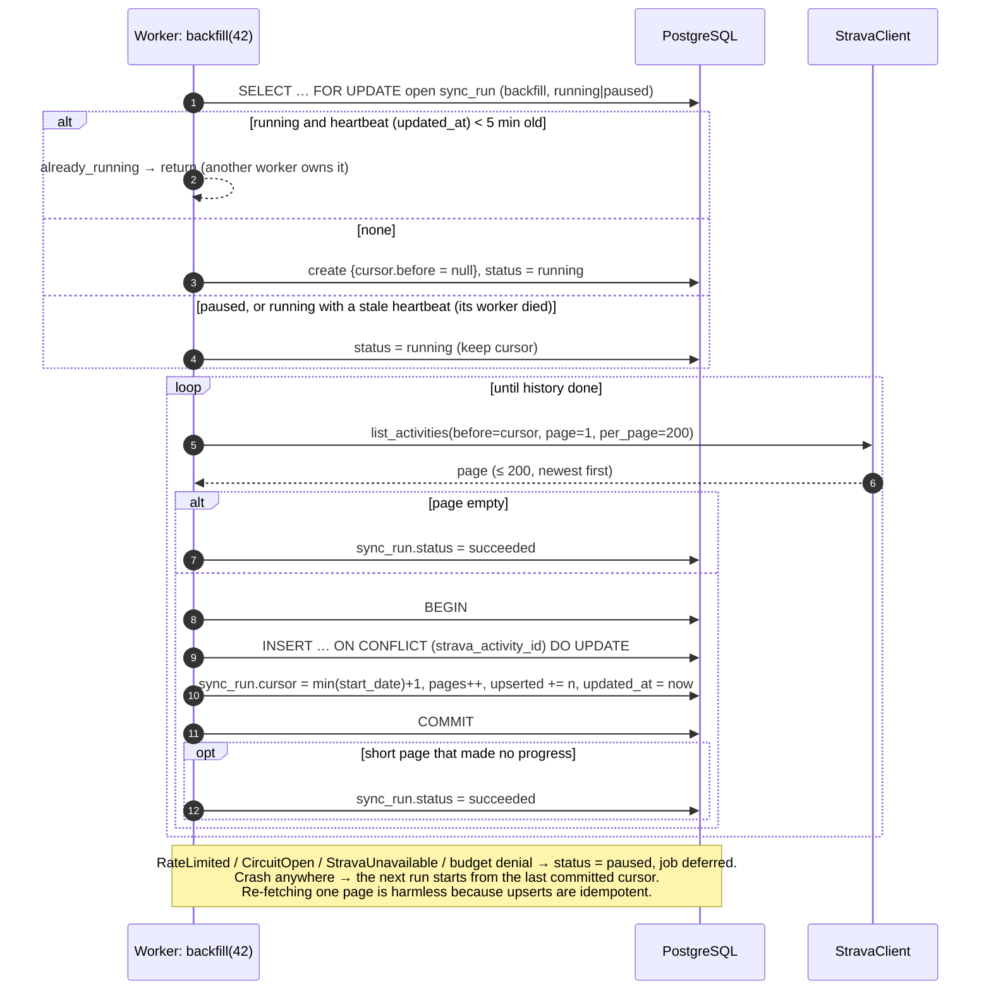

## 9. Sequence — webhook ack-then-process

```mermaid
sequenceDiagram
    autonumber
    participant S as Strava
    participant API as POST /webhooks/strava
    participant DB as PostgreSQL
    participant Q as Redis (arq)
    participant W as Worker
    participant C as StravaClient

    S->>API: event {object_type, object_id, aspect_type, event_time, …}
    API->>API: validate, dedup_key = sha256(sub:type:id:aspect:time)
    API->>DB: INSERT webhook_events ON CONFLICT (dedup_key) DO NOTHING RETURNING id
    alt new row
        API->>Q: enqueue process_webhook_event(id), job id webhook:{id}
        Note over API,Q: enqueue fails → still 200; retry cron recovers stale pending
    else duplicate
        Note over API: nothing to enqueue
    end
    API-->>S: 200 (measured p99 ≈ 7 ms locally, hard limit 2 s)

    Q->>W: process_webhook_event(id)
    W->>DB: claim: status pending|failed → processing, attempts++, last_attempt_at = now
    alt unknown owner / inactive athlete
        Note over W: nothing to do
    else activity create / update
        W->>C: get_activity(object_id, priority=high)
        C-->>W: current state (or 404 → treat as deleted)
        W->>DB: athlete active FOR SHARE? → upsert (or soft delete)
    else activity delete
        W->>DB: soft delete
    end
    alt done
        W->>DB: status = processed
    else RateLimited / CircuitOpen
        W->>DB: status = pending, job deferred (arq Retry)
    else other error
        W->>DB: status = failed (retry cron: backoff 2^n min, 8 attempts)
    end
```

## 10. Sequence — deauthorization

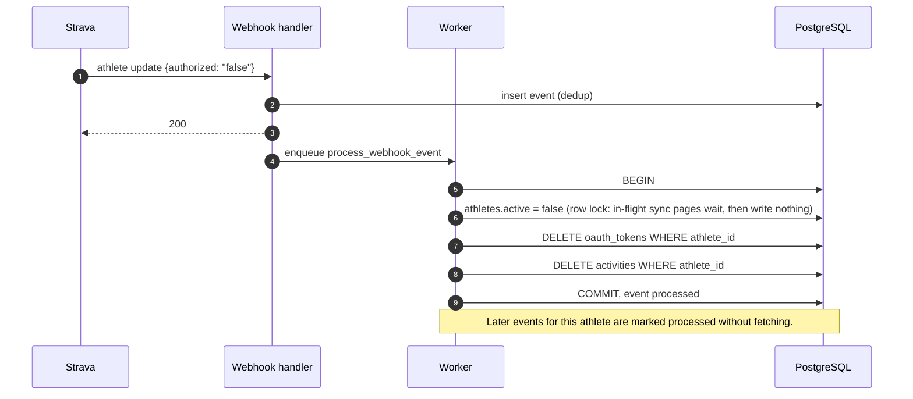

## 11. Sequence — dashboard request through the BFF

The browser only ever talks to the web server. The API key lives in the web server's environment
and is added in one place, `lib/upstream.ts` (ADR 0011).

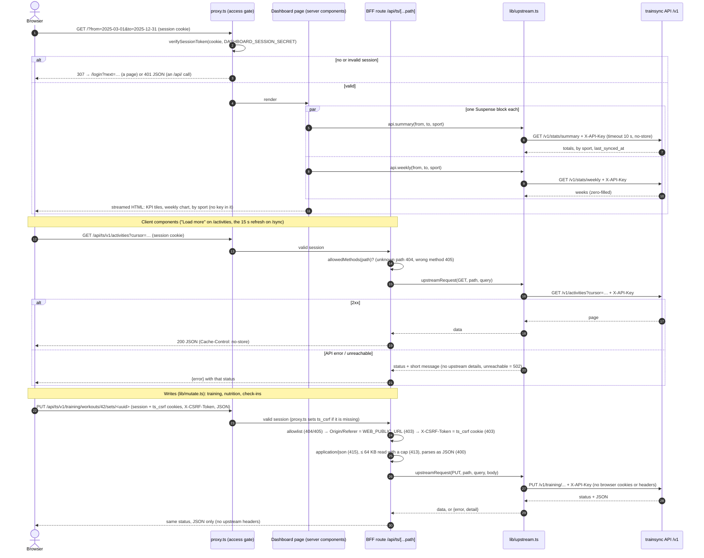

## 12. Sequence — new activity → notification

Only a live `activity create` webhook leads to a notification; backfill and incremental sync
import history and never enqueue one. Exactly one message per activity (ADR 0012).


## 13. State — circuit breaker

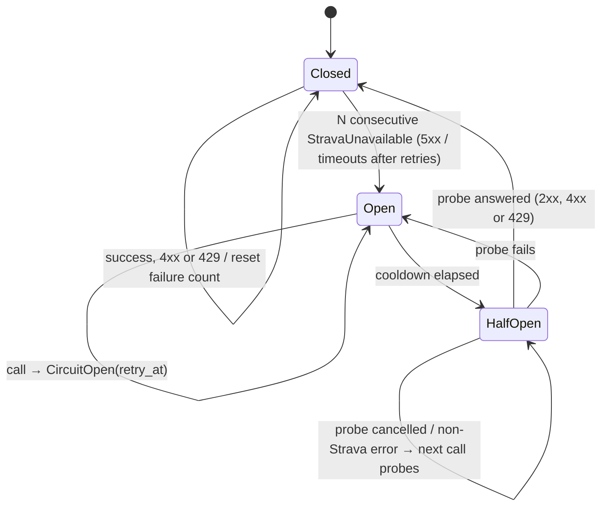

Per process (ADR 0005). Defaults: N = 5, cooldown = 30 s.

## 14. State — webhook event

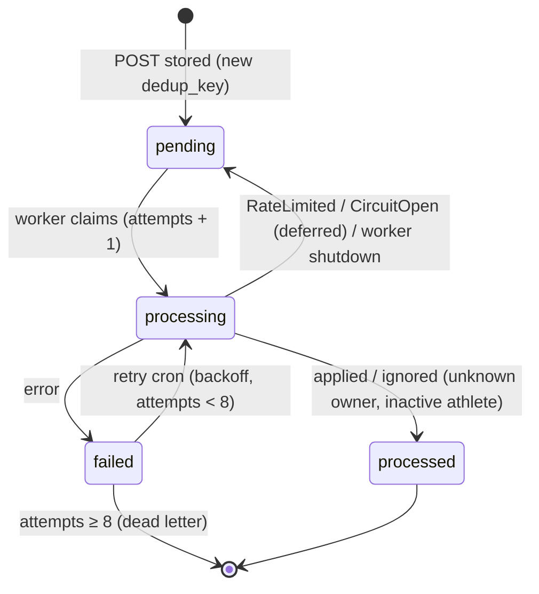

## 15. State — sync run

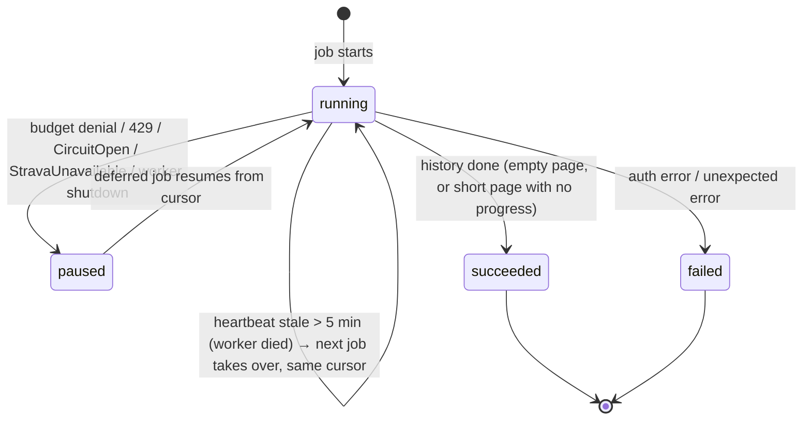

## 16. Activity — rate-limit budget decision


