# Diagrams

All diagrams are Mermaid, so GitHub renders them inline. They describe the design in
[architecture.md](architecture.md); keep them in sync when the code changes.

- [1. Component diagram](#1-component-diagram)
- [2. Deployment diagram (docker compose)](#2-deployment-diagram-docker-compose)
- [3. Data model (ER)](#3-data-model-er)
- [4. Class diagram — core modules](#4-class-diagram--core-modules)
- [5. Sequence — OAuth connect](#5-sequence--oauth-connect)
- [6. Sequence — token refresh with per-athlete lock](#6-sequence--token-refresh-with-per-athlete-lock)
- [7. Sequence — Strava call: retries, rate limit, breaker](#7-sequence--strava-call-retries-rate-limit-breaker)
- [8. Sequence — resumable backfill](#8-sequence--resumable-backfill)
- [9. Sequence — webhook ack-then-process](#9-sequence--webhook-ack-then-process)
- [10. Sequence — deauthorization](#10-sequence--deauthorization)
- [11. Sequence — dashboard request through the BFF](#11-sequence--dashboard-request-through-the-bff)
- [12. Sequence — new activity → notification](#12-sequence--new-activity--notification)
- [13. State — circuit breaker](#13-state--circuit-breaker)
- [14. State — webhook event](#14-state--webhook-event)
- [15. State — sync run](#15-state--sync-run)
- [16. Activity — rate-limit budget decision](#16-activity--rate-limit-budget-decision)
- [17. State — daily check-in conversation](#17-state--daily-check-in-conversation)
- [18. Sequence — evening check-in prompt](#18-sequence--evening-check-in-prompt)
- [19. Sequence — log a set with retry](#19-sequence--log-a-set-with-retry)
- [20. Sequence — rest timer and a backgrounded tab](#20-sequence--rest-timer-and-a-backgrounded-tab)
- [21. Deployment — production on the MacBook (Phase 7)](#21-deployment--production-on-the-macbook-phase-7)
- [22. Sequence — nightly backup and weekly restore check](#22-sequence--nightly-backup-and-weekly-restore-check-p74-adr-0024)
- [23. Activity — make deploy and make rollback](#23-activity--make-deploy-and-make-rollback-p75-adr-0026)
- [24. State — uptime and stack alerts](#24-state--uptime-and-stack-alerts-p78-adr-0027)
- [25. Deployment — public read-only demo](#25-deployment--public-read-only-demo-p79-adr-0028)
- [26. Sequence — the coach during a workout](#26-sequence--the-coach-during-a-workout-p611-adr-0030)
- [27. Sequence — /lang and the chat's language](#27-sequence--lang-and-the-chats-language-p612-adr-0031)
- [28. Activity — a chat message in savage mode](#28-activity--a-chat-message-in-savage-mode-profanity-and-the-guardrails-p613-adr-0032)
- [29. Layers — code layout and allowed imports](#29-layers--code-layout-and-allowed-imports-adr-0033)
- [30. Sequence — sign-up with an invite, then login through the BFF](#30-sequence--sign-up-with-an-invite-then-login-through-the-bff-p81-p87-adr-0034)
- [31. Sequence — linking a Telegram chat with /link](#31-sequence--linking-a-telegram-chat-with-link-p84-adr-0036)
- [32. Sequence — progress summary with the versioned cache](#32-sequence--progress-summary-with-the-versioned-cache-p810-adr-0038)
- [33. Sequence — Monday progress digest](#33-sequence--monday-progress-digest-p811-adr-0038)

---

## 1. Component diagram

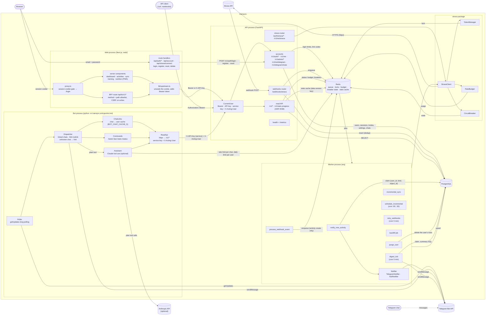

The web app and the bot are clients of the read API: neither touches PostgreSQL (ADRs 0011, 0012).
The web holds no API key: each browser's API session token travels sealed in its httpOnly cookie
(ADR 0034). The bot acts as the user its chat is linked to, with a service key the public gateway
cannot impersonate because it strips `X-Acting-User` (ADR 0036). New-activity notifications run in the worker with its own
Telegram client, so they do not depend on the bot process.

## 2. Deployment diagram (docker compose)

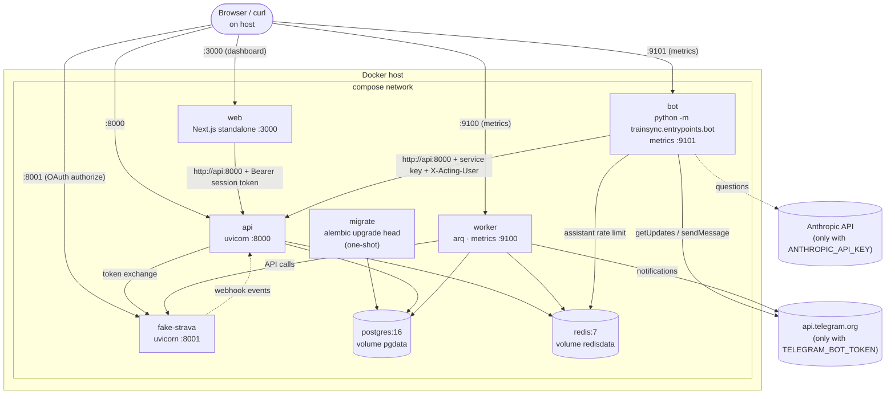

Without `TELEGRAM_BOT_TOKEN` the bot does not poll (it only serves its metrics and stays healthy)
and the worker uses the `NullNotifier`, so the stack and `make compose-smoke` behave the same with
or without a token.

## 3. Data model (ER)

Since Phase 8 (ADR 0035) every user-owned table has `user_id` → `users` (`ON DELETE CASCADE`);
the diagrams draw that edge once per table. Shared rows (built-in exercises, the food catalogue)
have `user_id` NULL.

### Accounts (Phase 8, ADR 0034, ADR 0036)

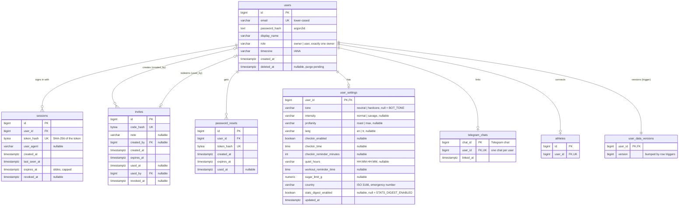

`user_settings` replaced `chat_settings` (migration 0017); a NULL column means the environment
default. The `/link` code lives in Redis, not in a table. `user_data_versions` (migration 0018,
ADR 0038) gets its row from a trigger on `users`; `bump_user_data_version` increments it on every
insert, update and delete in the tables of `stats/models.py` `VERSIONED_TABLES` (activities,
workouts, sets, exercises, programs and their days and exercises, food logs, nutrition profile,
body metrics, check-ins). The statistics cache key carries it.

### Strava, sync and nutrition

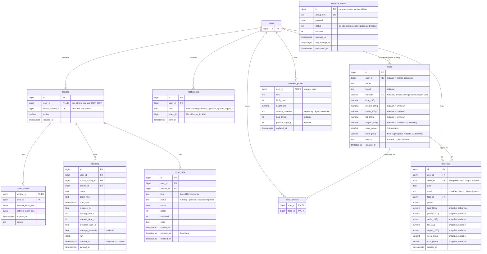

Nutrition (P6.4, ADR 0019) has no `athlete_id`; it belongs to the user. Body weight for the BMR
estimate comes from `body_metrics` (training), exercise energy from `activities.raw`.

`notifications.object_id` has no foreign key: a row is the idempotency claim for one message
(ADR 0012), kept even if the activity is deleted later; only `user_id` is a foreign key.

### Training (Phase 6, per user since Phase 8)

No `athlete_id`; every table has `user_id` (built-in exercises: NULL). `workouts.strava_activity_id`
is a link, not a foreign key.

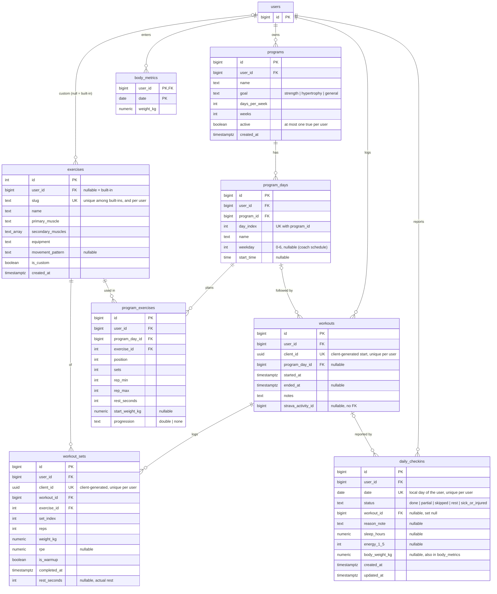

## 4. Class diagram — core modules

Generated from the code (public methods; Protocols shown as interfaces).

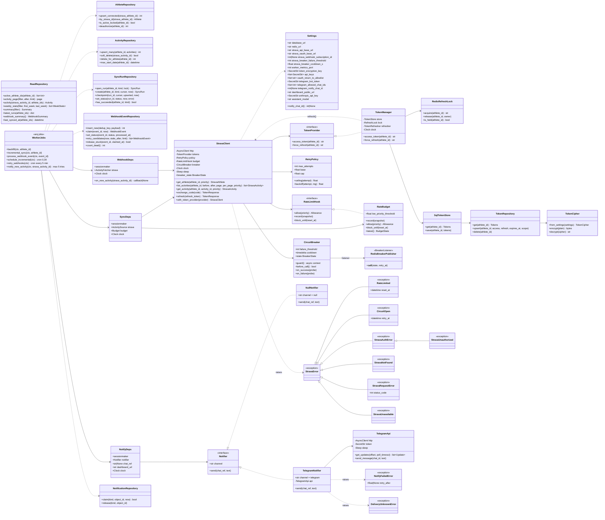

## 5. Sequence — OAuth connect

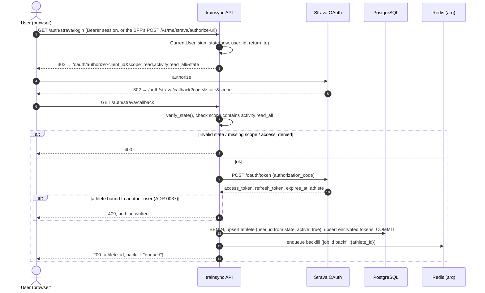

## 6. Sequence — token refresh with per-athlete lock

Two jobs need a token for the same athlete at the same moment, and the token is about to expire.

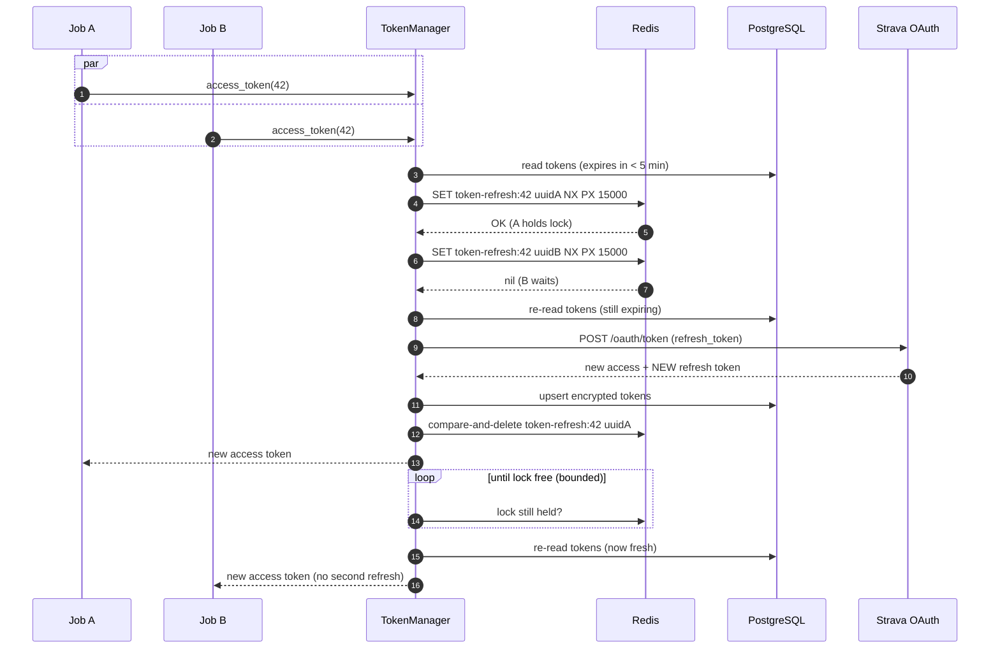

## 7. Sequence — Strava call: retries, rate limit, breaker

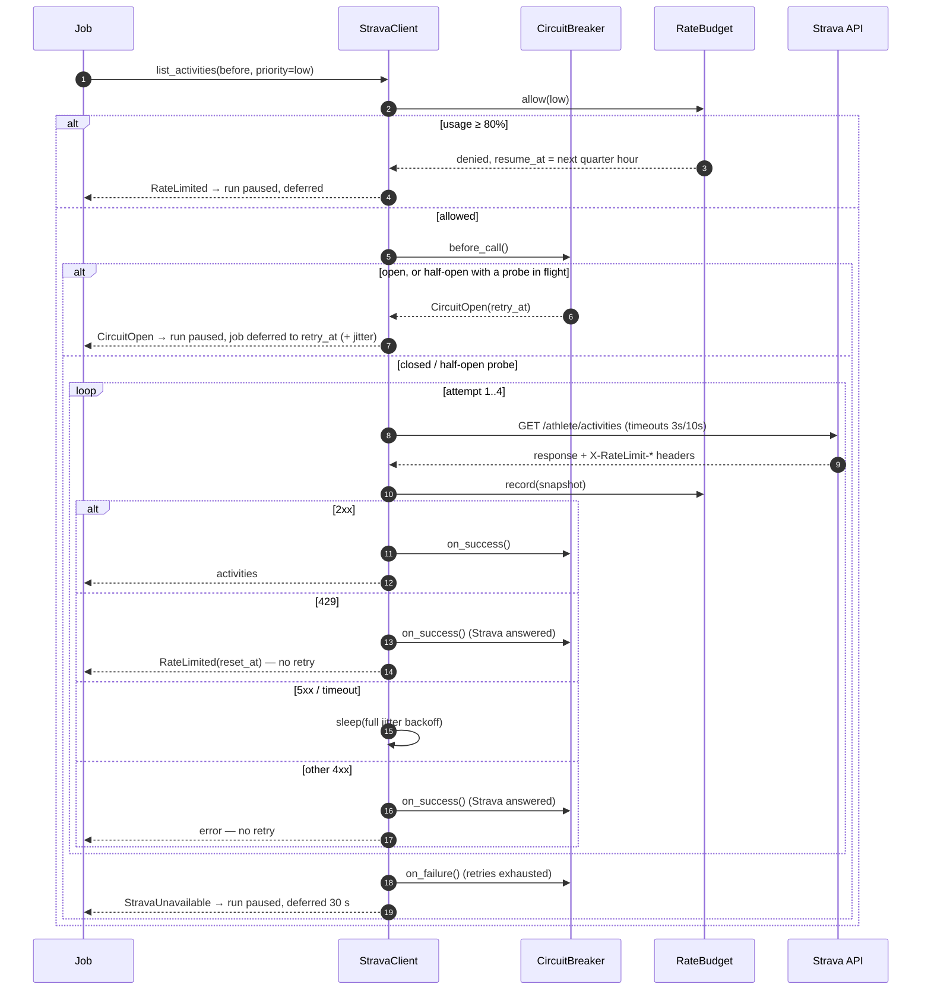

## 8. Sequence — resumable backfill

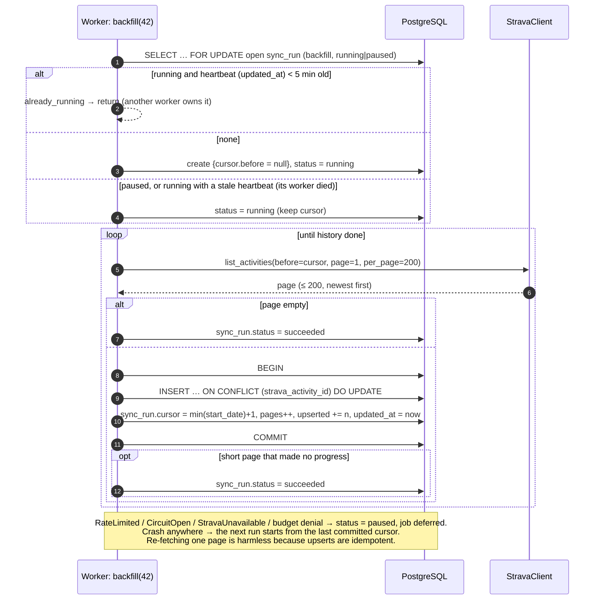

## 9. Sequence — webhook ack-then-process

```mermaid
sequenceDiagram
    autonumber
    participant S as Strava
    participant API as POST /webhooks/strava
    participant DB as PostgreSQL
    participant Q as Redis (arq)
    participant W as Worker
    participant C as StravaClient

    S->>API: event {object_type, object_id, aspect_type, event_time, …}
    API->>API: validate, dedup_key = sha256(sub:type:id:aspect:time)
    API->>DB: INSERT webhook_events ON CONFLICT (dedup_key) DO NOTHING RETURNING id
    alt new row
        API->>Q: enqueue process_webhook_event(id), job id webhook:{id}
        Note over API,Q: enqueue fails → still 200; retry cron recovers stale pending
    else duplicate
        Note over API: nothing to enqueue
    end
    API-->>S: 200 (measured p99 ≈ 7 ms locally, hard limit 2 s)

    Q->>W: process_webhook_event(id)
    W->>DB: claim: status pending|failed → processing, attempts++, last_attempt_at = now
    alt unknown owner / inactive athlete
        Note over W: nothing to do
    else activity create / update
        W->>C: get_activity(object_id, priority=high)
        C-->>W: current state (or 404 → treat as deleted)
        W->>DB: athlete active FOR SHARE? → upsert (or soft delete)
    else activity delete
        W->>DB: soft delete
    end
    alt done
        W->>DB: status = processed
    else RateLimited / CircuitOpen
        W->>DB: status = pending, job deferred (arq Retry)
    else other error
        W->>DB: status = failed (retry cron: backoff 2^n min, 8 attempts)
    end
```

## 10. Sequence — deauthorization

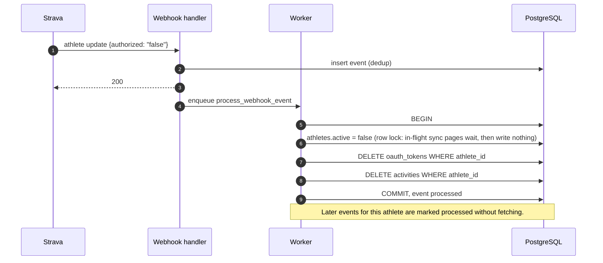

## 11. Sequence — dashboard request through the BFF

The browser only ever talks to the web server. The web holds no API key: the user's API session
token is sealed in the `ts_session` cookie (AES-256-GCM, `DASHBOARD_SESSION_SECRET`) and added as
`Authorization: Bearer` in one place, `lib/upstream.ts` (ADR 0011, ADR 0034). A 401 from the API
clears the cookie and sends the browser to `/login`.

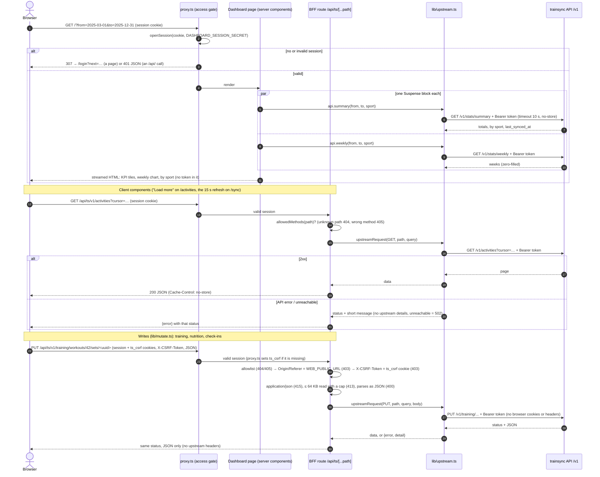

## 12. Sequence — new activity → notification

Only a live `activity create` webhook leads to a notification; backfill and incremental sync
import history and never enqueue one. Exactly one message per activity (ADR 0012).

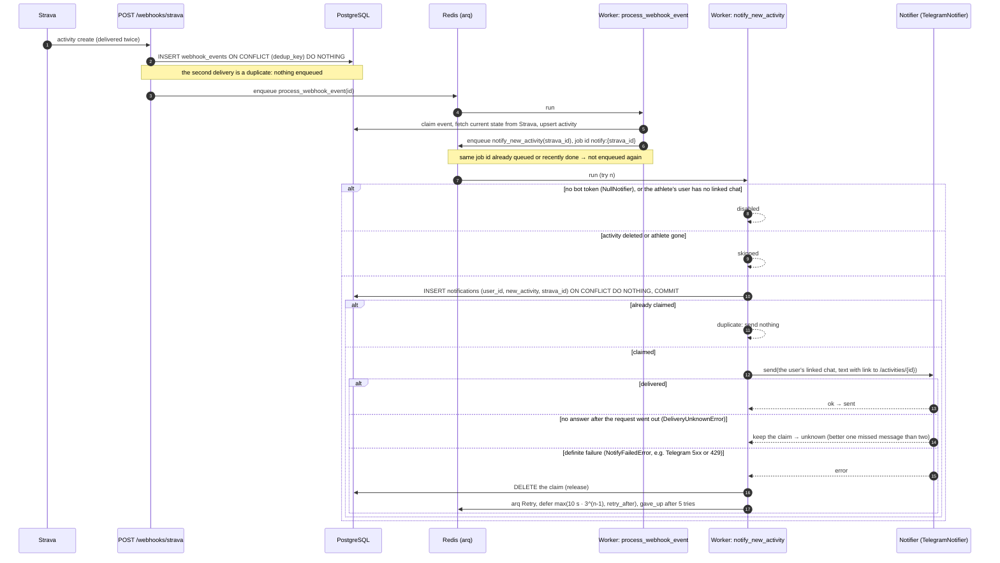

## 13. State — circuit breaker

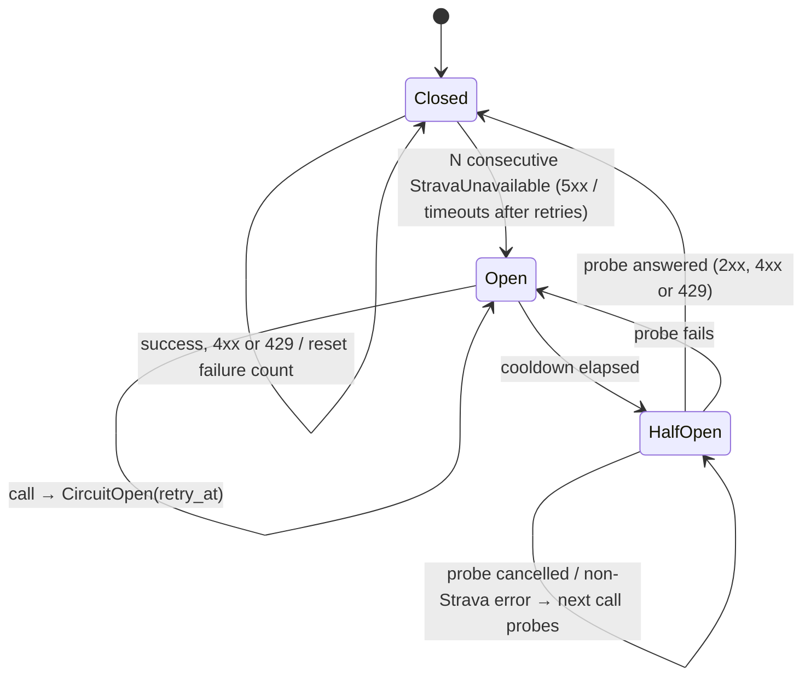

Per process (ADR 0005). Defaults: N = 5, cooldown = 30 s.

## 14. State — webhook event

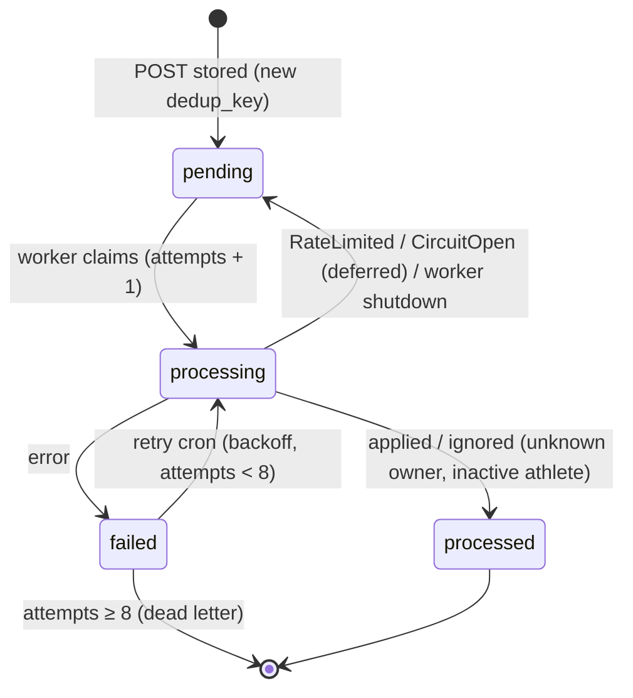

## 15. State — sync run

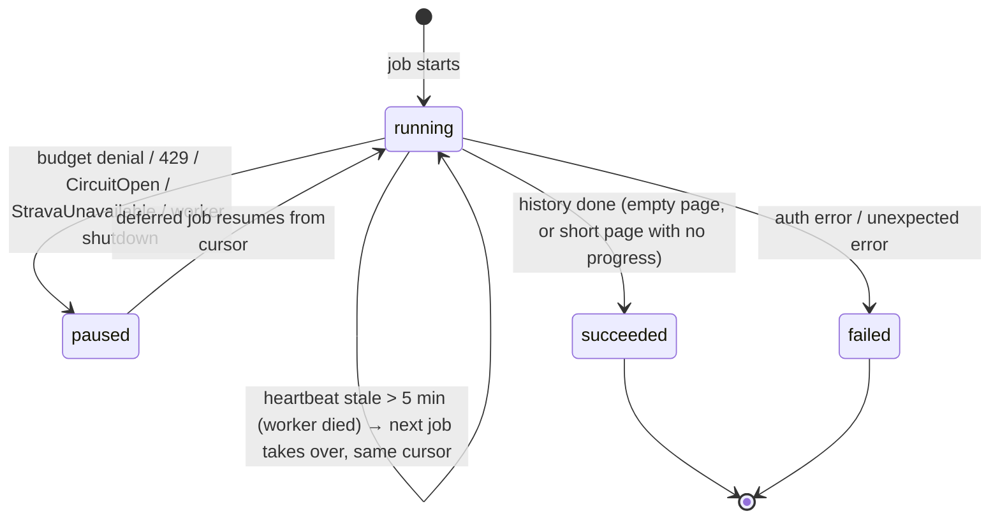

## 16. Activity — rate-limit budget decision


## 17. State — daily check-in conversation

State in Redis (`checkin:{chat}:{yyyymmdd}`, 6 h TTL). Every transition raises `seq`; buttons carry
`ci:{yyyymmdd}:{seq}:{action}`, so a button from an older message, a double tap or a redelivered
press no longer matches and gets a polite "earlier question" toast. A redelivered text answer has
an `update_id` the state already saw and is ignored (ADR 0020).

```mermaid
stateDiagram-v2
    [*] --> status : /report, "rapor", or the worker's prompt (seq 0)
    status --> exercise : Done / Partly, active program<br/>(PUT check-in, start or reuse today's workout)
    status --> freeform : Done / Partly, no program
    status --> reason : Skipped
    status --> scale : Rest / Sick (stored, no pushing)
    exercise --> exercise : As planned / ±2.5 kg / typed sets / Skip exercise<br/>(PUT sets, next exercise)
    exercise --> exercise : invalid input → re-prompt
    exercise --> scale : last exercise
    freeform --> freeform : "bench 80x5x3" (PUT sets) / numbered choice
    freeform --> scale : Finish / "done"
    reason --> scale : text, or Skip (hardcore may push here only)
    scale --> sleep : number or Skip
    sleep --> energy : number or Skip
    energy --> done : 1-5 or Skip<br/>(PUT check-in, summary with volume, PRs, streak)
    done --> status : Edit (same client ids: overwrite, never duplicate)
    done --> [*] : TTL 6 h
```

## 18. Sequence — evening check-in prompt

```mermaid
sequenceDiagram
    autonumber
    participant Cron as worker cron (every 5 min)
    participant DB as Postgres
    participant TG as Telegram
    participant Bot as bot process
    participant API as API
    Note over Cron,DB: for each user with a linked chat (Phase 8), in the user's time zone
    Cron->>DB: check-in for the user's local today? prompt / reminder claimed?
    alt before the user's check-in time (default CHECKIN_TIME), or answered
        Cron-->>Cron: nothing
    else due and not sent yet
        Cron->>DB: claim (user_id, checkin_prompt, yyyymmdd) — ON CONFLICT DO NOTHING
        Cron->>TG: sendMessage to the linked chat + 5 status buttons (seq 0)
        Note over Cron,DB: failure → release, next tick retries;<br/>unknown outcome → keep the claim
    else prompt sent ≥ CHECKIN_REMINDER_MINUTES ago, unanswered
        Cron->>DB: claim (user_id, checkin_reminder, yyyymmdd)
        Cron->>TG: one reminder
    end
    TG-->>Bot: callback_query (getUpdates)
    Bot->>API: PUT /v1/checkins/{date} (status) + service key + X-Acting-User
    Bot->>TG: answerCallbackQuery, remove buttons, next question
```

## 19. Sequence — log a set with retry

The client id is created once per set row, so a double tap, a retry and a replay from the queue
are the same `PUT` (ADR 0017). Gym Wi-Fi drops the answer, not the request, in the second case.

```mermaid
sequenceDiagram
    autonumber
    participant UI as Workout screen
    participant Q as Retry queue (localStorage)
    participant BFF as BFF /api/ts
    participant API as API
    participant DB as Postgres

    Note over UI,API: the workout itself was started the same way: PUT /v1/training/workouts/{uuid W}
    UI->>UI: tap ✓ (row already has client_id = uuid A)
    UI->>BFF: PUT /v1/training/workouts/42/sets/A (CSRF token, JSON)
    BFF->>API: PUT … + Bearer token
    API->>DB: INSERT … ON CONFLICT (user_id, client_id) DO UPDATE … RETURNING xmax = 0
    DB-->>API: row, created
    API-->>UI: 201 set
    UI->>UI: second tap on the same row: same uuid A
    UI->>BFF: PUT …/sets/A
    BFF->>API: PUT …/sets/A
    API->>DB: upsert, conflict → update
    API-->>UI: 200, same body (still one row)
    UI->>BFF: PUT …/sets/B (next set)
    BFF->>API: PUT …/sets/B
    API->>DB: upsert (stored)
    API--xUI: answer lost (Wi-Fi drop, status 0)
    UI->>Q: keep {path …/sets/B, body}
    Note over UI,Q: browser fires `online`, or the next write succeeds
    Q->>BFF: PUT …/sets/B (same path, same body)
    BFF->>API: PUT …/sets/B
    API->>DB: upsert, conflict → update
    API-->>Q: 200, entry leaves the queue (still one row)
    Note over Q,API: a 4xx answer is final: the entry is dropped and shown as an error
```

## 20. Sequence — rest timer and a backgrounded tab

Timers store absolute times and render `endsAt − now()`, so frozen intervals in a backgrounded
tab or behind a locked screen do not matter (ADR 0021).

```mermaid
sequenceDiagram
    autonumber
    participant U as Lifter
    participant UI as Workout screen
    participant LS as localStorage
    participant OS as Browser / phone

    U->>UI: log set 2 of Bench Press (rest 90 s)
    UI->>LS: save {endsAt: now + 90 000, alerted: false}
    loop every 250 ms while visible
        UI->>UI: render ceil((endsAt − now) / 1000)
    end
    U->>OS: lock the screen
    OS-->>UI: intervals throttled or frozen
    Note over UI: 3 minutes pass, nothing renders
    U->>OS: unlock
    OS-->>UI: visibilitychange / next tick
    UI->>UI: remaining = max(0, endsAt − now) = 0 → 0:00
    alt zero passed less than 60 s ago and not alerted
        UI->>OS: vibrate, beep, optional Notification
        UI->>LS: alerted = true
    else asleep long past zero
        UI->>LS: alerted = true (no late alarm)
    end
    U->>UI: reload the page
    UI->>LS: read state for workout 42
    LS-->>UI: endsAt, alerted (timer restored, no repeated alert)
```

## 21. Deployment — production on the MacBook (Phase 7)

```mermaid
flowchart TB
    strava[("Strava<br/>OAuth + webhooks")]
    vercel["Vercel<br/>web/ BFF (server-side)"]
    gha["GitHub Actions<br/>public-check (every 6 h) · uptime (every 15 min)"]
    tg["Telegram"]

    subgraph ts["Tailscale"]
        funnel["Funnel · TLS for &lt;mac&gt;.&lt;tailnet&gt;.ts.net<br/>:443 real · :8443 demo"]
    end

    subgraph mac["MacBook (always on, no AC sleep)"]
        agent["LaunchAgent com.trainsync.stack<br/>at login: wait for Docker → mac-prod.sh up"]
        deploy["make deploy / make rollback<br/>(green CI, pre-deploy backup, migrate, smoke)"]
        icloud[("iCloud Drive<br/>trainsync-backups (*.dump.age)")]
        demo["compose.demo.yml · 127.0.0.1:8081<br/>read-only demo (diagram 25)"]
        subgraph dd["Docker Desktop · compose.prod.yml"]
            gw["gateway (Caddy)<br/>127.0.0.1:8080 · route allowlist<br/>strips X-Acting-User · /v1/auth/* 30/min"]
            api["api"]
            worker["worker"]
            bot["bot"]
            backup["backup<br/>nightly pg_dump + age · retention · weekly restore check"]
            subgraph backend["backend network (internal)"]
                pg[("postgres")]
                rd[("redis")]
            end
        end
    end

    strava -- "https://host/auth/strava/callback<br/>https://host/webhooks/strava" --> funnel
    vercel -- "https://host/v1/* + Bearer session token" --> funnel
    gha -- "allowlisted → forwarded<br/>everything else → 404" --> funnel
    funnel -- "http 127.0.0.1:8080" --> gw
    gw --> api
    api --> pg
    api --> rd
    worker --> pg
    worker --> rd
    bot --> api
    agent -. "docker compose up" .-> dd
    deploy -. "images tagged by git SHA" .-> dd
    funnel -- "http 127.0.0.1:8081" --> demo
    backup --> pg
    backup -- "encrypted dumps" --> icloud
    worker -. "reads backup age" .-> icloud
    backup -. "backup / restore-check result" .-> tg
    gha -. "uptime: down / recovered" .-> tg
    worker -. "stack alerts: start / clear" .-> tg
```

## 22. Sequence — nightly backup and weekly restore check (P7.4, ADR 0024)

```mermaid
sequenceDiagram
    participant L as backup loop
    participant PG as postgres
    participant D as BACKUP_DIR (iCloud Drive)
    participant S as scratch Postgres (in the backup container)
    participant T as Telegram
    loop every minute
        L->>D: due? (slot passed, no backup since)
    end
    L->>PG: BEGIN REPEATABLE READ; pg_export_snapshot()
    L->>PG: row counts of every table (same snapshot)
    L->>PG: pg_dump -Fc --snapshot
    L->>D: age -r recipient → .name.partial, then rename .counts.json and .dump.age
    L->>D: retention (7 daily / 4 weekly / 6 monthly)
    alt restore-check weekday and identity mounted
        L->>S: age -d (authenticated) → pg_restore
        L->>S: row counts
        L->>L: compare with .counts.json
        L->>T: passed / FAILED
    else backup failed
        L->>T: backup FAILED, retry in 1 h
    end
```

## 23. Activity — make deploy and make rollback (P7.5, ADR 0026)

```mermaid
flowchart TD
    start(["make deploy"]) --> clean{"clean worktree, branch main,<br/>HEAD == origin/main after fetch?"}
    clean -- no --> refuse(["refuse · deploys.log"])
    clean -- yes --> ci{"gh run list --commit SHA --workflow ci<br/>completed success?"}
    ci -- no --> refuse
    ci -- yes --> build["build images, TRAINSYNC_TAG = SHA[:12]"]
    build --> backup["backup now predeploy&lt;sha7&gt;"]
    backup --> before["alembic current → rev_before"]
    before --> migrate["one-shot migrate: alembic upgrade head → rev_after"]
    migrate --> state["deploy-state: current = new, previous = old, rev_before"]
    state --> up["up -d"]
    up --> smoke{"smoke: /health/ready via gateway,<br/>/v1/sync/status with an API key, bot getMe"}
    smoke -- ok --> done(["success · deploys.log · Telegram"])
    smoke -- fail --> rb
    build & backup & migrate -- fail --> abort(["abort: the old version keeps running · Telegram"])

    rbstart(["make rollback"]) --> rb{"previous deploy recorded<br/>and its image present?"}
    rb -- no --> rbrefuse(["refuse"])
    rb -- yes --> crossed{"migrations between<br/>rev_before and rev_after?"}
    crossed -- none --> old["up -d with the previous tag"]
    crossed -- "all reversible = True" --> down["alembic downgrade rev_before<br/>(new image: it has the downgrade code)"]
    down --> old
    crossed -- "any reversible = False" --> restore(["refuse · print the restore steps<br/>(pre-deploy backup, then rollback --restored)"])
    old --> rbdone(["smoke test · deploy-state: current = previous · Telegram"])
```

## 24. State — uptime and stack alerts (P7.8, ADR 0027)

External uptime, per target (`src/trainsync/ops/uptime.py`, run by `.github/workflows/uptime.yml`
every 15 minutes; state in the Actions cache). Threshold 2: flapping (fail, ok, fail, ok) never
reaches `down`.

```mermaid
stateDiagram-v2
    [*] --> up
    up --> up: ok
    up --> failing: fail (n = 1)
    failing --> up: ok
    failing --> failing: fail, n + 1 below 2
    failing --> down: fail, n + 1 reaches 2 / send DOWN
    down --> down: fail / nothing
    down --> up: ok / send RECOVERED
    note right of down
        a failed send keeps the old state:
        the next run sends again
    end note
```

Stack alerts, per condition (`src/trainsync/modules/notifications/alerts.py`, worker cron every 5 minutes; state
in Redis `alert:<condition>`). Grace: 30 min for the circuit breaker, 0 for the others (their
threshold is in the observation: dead letters > 0, backup > 36 h, sync > 2 h).

```mermaid
stateDiagram-v2
    [*] --> ok
    ok --> pending: bad (bad_since = now)
    pending --> ok: ok / nothing
    pending --> pending: bad, inside the grace
    pending --> alerted: bad, grace over / send alert
    alerted --> alerted: bad / nothing
    alerted --> ok: ok / send resolved
    note left of pending
        unknown (no breaker report,
        never synced) changes nothing
    end note
```

## 25. Deployment — public read-only demo (P7.9, ADR 0028)

```mermaid
flowchart TB
    visitor["Visitor (README link)"]
    preview["Vercel preview<br/>web/ BFF · demo account<br/>demo@trainsync.invalid"]

    subgraph ts["Tailscale"]
        funnel["Funnel :8443"]
    end

    subgraph dd["Docker Desktop · compose.demo.yml (project trainsync-demo)"]
        gw["gateway (same Caddy image + routes.toml)<br/>127.0.0.1:8081"]
        api["api · DEMO_MODE=true<br/>DemoReadOnlyMiddleware: writes → 403<br/>except login / logout"]
        subgraph backend["backend network (internal)"]
            pg[("postgres · demo-pgdata")]
            rd[("redis")]
            fs["fake_strava (no real Strava)"]
            worker["demo worker<br/>reset cron 03:00 UTC"]
            seed["seed (one-shot on up)<br/>python -m trainsync.entrypoints.demo reset"]
        end
    end

    visitor --> preview
    preview -- "POST /v1/auth/login, then GET /v1/* + Bearer" --> funnel
    funnel -- "http 127.0.0.1:8081" --> gw
    gw --> api
    api -- "reads" --> pg
    api --> rd
    seed -- "wipe + synthetic dataset<br/>(seed.py, fixed RNG)" --> pg
    worker -- "same reset nightly" --> pg
    api -. "Strava URLs point here" .-> fs
```

## 26. Sequence — the coach during a workout (P6.11, ADR 0030)

Every message claims a `notifications` row first; quiet hours drop it; check-in workouts get none.

```mermaid
sequenceDiagram
    autonumber
    participant C as Client (web / bot)
    participant API as API
    participant Q as arq (Redis)
    participant W as Worker (coach jobs)
    participant T as Telegram

    C->>API: PUT /v1/training/workouts/{client_id} (201)
    API->>Q: coach_workout_started:{id}
    Q->>W: coach_workout_started
    W->>T: start line (savage or tone pack)
    C->>API: PUT …/sets/{client_id} (201)
    API->>Q: coach_set_logged:{set id}
    Q->>W: coach_set_logged
    alt below plan (reps < rep_min or lighter than the suggestion)
        W->>T: under target (once per exercise per workout)
    end
    W->>Q: coach_rest_over, deferred to completed_at + rest_seconds
    Q->>W: coach_rest_over
    alt still the latest set, planned sets left, not late
        W->>T: "kalk, sıradaki set"
    end
    C->>API: POST …/finish
    API->>Q: coach_workout_finished:{id}
    Q->>W: coach_workout_finished
    W->>T: summary + PRs + verdict (good / missing sets)
```

## 27. Sequence — /lang and the chat's language (P6.12, ADR 0031)

`BOT_LANG` is the default; a stored choice wins. The bot sets the language once per update, the
worker once per job, read at send time. Since Phase 8 the choice is the linked user's
`user_settings.lang` (ADR 0036).

```mermaid
sequenceDiagram
    autonumber
    participant U as User (linked Telegram chat)
    participant B as Bot
    participant API as API
    participant DB as Postgres (user_settings)
    participant W as Worker

    U->>B: /lang
    B->>API: GET /v1/telegram/chats/{chat} (user id + settings, cached BOT_CHAT_CACHE_S)
    API->>DB: SELECT telegram_chats, user_settings
    B-->>U: "Türkçe" / "English" buttons
    U->>B: press "English"
    B->>API: PATCH /v1/me/settings {"lang": "en"} + service key + X-Acting-User
    API->>DB: upsert user_settings
    B->>B: drop the chat's cache entry
    B-->>U: confirmation in English (savage line in savage mode)
    Note over W: a reminder, check-in or notification for this user is due
    W->>DB: SELECT the user's settings and linked chat
    W-->>U: message in English
```

## 28. Activity — a chat message in savage mode, profanity and the guardrails (P6.13, ADR 0032)

Distress first, then pain, then the triggers. The calm replies never get a max opener; every other
savage message does in max, unless it already carries a max line.

```mermaid
flowchart TD
    M[chat message] --> D{distress?<br/>guilt, threw up, not eating,<br/>self-hate, binge}
    D -- yes --> C1[calm SAFETY_DISTRESS reply<br/>no swearing, no assistant]
    D -- no --> P{pain, injury, illness?}
    P -- yes --> C2[calm SAFETY_PAIN reply<br/>no swearing, no assistant]
    P -- no --> S{savage in effect?<br/>configured, not /yumusak}
    S -- no --> N[tone pack / assistant]
    S -- yes --> F{unhealthy choice?<br/>junk, sugar, alcohol,<br/>cigarettes, up late}
    F -- yes --> R1[food_roast line + one move<br/>+ day's target unchanged]
    F -- no --> E{excuse?}
    E -- yes --> R2[excuse roast + one action today]
    E -- no --> N
    R1 & R2 & N --> L{profanity max?<br/>/swear, else BOT_PROFANITY}
    L -- roast --> OUT[send]
    L -- max --> O[lines from the max pools;<br/>max_opener in front of a message<br/>with no savage line]
    O --> OUT
    C1 & C2 --> OUT
```

## 29. Layers — code layout and allowed imports (ADR 0033)

Imports only point down. import-linter checks the layer order, the independence of the
entrypoints, the module order and that `ops` stays standard-library only (`make lint`). Every
module may import any module's `models.py`. `stats` has its own layer between `chat` and
`admin | users` because it reads check-ins, nutrition rules and user settings (ADR 0038).

```mermaid
flowchart TB
  subgraph E["entrypoints"]
    direction LR
    eapi["api"] ~~~ eworker["worker"] ~~~ ebot["bot"] ~~~ edemo["demo"] ~~~ ecli["cli"]
  end
  subgraph M["modules"]
    notifications --> chat
    chat --> stats
    stats --> users & admin
    users & admin --> coach & checkin & nutrition & sync
    coach & checkin & nutrition --> training
    training & nutrition & sync --> activities
    activities --> strava
    sync --> strava
    strava --> auth
  end
  subgraph I["integrations"]
    direction LR
    istrava["strava"] ~~~ itelegram["telegram"] ~~~ ianthropic["anthropic"] ~~~ ioff["openfoodfacts"]
  end
  C["core"]
  E --> M --> I --> C
  O["ops (stdlib only)"]
```

## 30. Sequence — sign-up with an invite, then login through the BFF (P8.1, P8.7, ADR 0034)

The owner hands out the invite; nothing is mailed. The browser never sees the API token: the BFF
seals it into the httpOnly `ts_session` cookie.

```mermaid
sequenceDiagram
    autonumber
    actor O as Owner (Mac shell)
    actor U as New user (browser)
    participant CLI as cli invite create
    participant BFF as Web BFF (/api/auth/*)
    participant API as trainsync API
    participant R as Redis (limits)
    participant DB as PostgreSQL

    O->>CLI: invite create --note "Ayşe"
    CLI->>DB: INSERT invites (code_hash, expires_at = now + INVITE_TTL_DAYS)
    CLI-->>O: code + DASHBOARD_PUBLIC_URL/register?invite=CODE
    O-->>U: sends the link
    U->>BFF: POST /api/auth/register {email, password, invite_code} (same Origin)
    BFF->>API: POST /v1/auth/register
    API->>R: registrations per address < REGISTER_MAX_PER_HOUR?
    alt REGISTRATION_MODE=closed
        API-->>BFF: 403
    else invite missing, used or expired
        API-->>BFF: 400
    else email taken
        API-->>BFF: 409
    else ok
        API->>DB: BEGIN, INSERT users (argon2id hash, role user), mark invite used, COMMIT
        API-->>BFF: 201 me
        BFF->>API: POST /v1/auth/login {email, password}
        API->>R: failures for this email / address under LOGIN_MAX_FAILURES*?
        API->>DB: verify argon2id, INSERT sessions (SHA-256 of a random 32-byte token)
        API-->>BFF: {token, expires_at, user}
        BFF->>BFF: seal token (AES-256-GCM, DASHBOARD_SESSION_SECRET)
        BFF-->>U: 303 → next, Set-Cookie ts_session (httpOnly, Secure, SameSite=Lax) + ts_csrf
    end

    Note over U,API: Later requests
    U->>BFF: GET a page (ts_session)
    BFF->>API: GET /v1/... + Authorization: Bearer token
    API->>DB: session by token hash: not revoked, not expired, slide expires_at (at most every SESSION_TOUCH_INTERVAL_S, capped at SESSION_MAX_AGE_DAYS)
    alt valid
        API-->>BFF: the user's data only
    else revoked or expired
        API-->>BFF: 401
        BFF-->>U: clear ts_session, 307 → /login
    end
```

## 31. Sequence — linking a Telegram chat with /link (P8.4, ADR 0036)

One bot serves every account. The bot never touches the database; it acts as the linked user
with its service key and `X-Acting-User`, a header the public gateway strips.

```mermaid
sequenceDiagram
    autonumber
    actor U as User
    participant BFF as Web BFF
    participant API as trainsync API
    participant R as Redis
    participant DB as PostgreSQL
    participant B as Bot
    participant TG as Telegram

    U->>BFF: "Link Telegram"
    BFF->>API: POST /v1/me/telegram/code + Bearer token
    API->>R: SET link code → user_id (TTL TELEGRAM_LINK_CODE_TTL_MINUTES)
    API-->>BFF: {code, command: "/link CODE", bot_url (with TELEGRAM_BOT_USERNAME)}
    BFF-->>U: shows the code
    U->>TG: /link CODE (to the bot)
    TG-->>B: getUpdates
    B->>API: GET /v1/telegram/chats/{chat_id} + service key
    API-->>B: 404 chat not linked
    B->>API: POST /v1/telegram/chats/{chat_id}/link {code} + service key
    API->>R: GET + DELETE code (single use)
    alt unknown, used or expired code
        API-->>B: 400
        B-->>TG: "invalid or expired code"
    else ok
        API->>DB: upsert telegram_chats (chat_id → user_id, the user's previous chat unlinked)
        API-->>B: {chat_id, user_id, display_name, settings}
        B->>B: cache chat → user (BOT_CHAT_CACHE_S)
        B-->>TG: "linked" in the user's language
    end

    Note over U,TG: Afterwards
    U->>TG: /week
    TG-->>B: getUpdates
    B->>API: GET /v1/stats/weekly + service key + X-Acting-User: user_id
    API-->>B: that user's weeks only
    B-->>TG: reply in the user's tone and language

    Note over B,TG: Any other chat that is not linked
    B-->>TG: one hint: link your account at DASHBOARD_PUBLIC_URL (nothing else runs)
```

## 32. Sequence — progress summary with the versioned cache (P8.10, ADR 0038)

Short windows are computed every time; windows of `STATS_CACHE_MIN_DAYS` or more go through
Redis. Any write to a table the statistics read bumps the version, so the next request builds a
new key; the old entry is never read again and expires after `STATS_CACHE_TTL_S`.

```mermaid
sequenceDiagram
    autonumber
    participant C as Client (BFF, bot, curl)
    participant API as trainsync API
    participant DB as PostgreSQL
    participant R as Redis

    C->>API: GET /v1/stats/summary?period=12m
    API->>API: resolve period → local days in the user's zone, previous period
    alt window < STATS_CACHE_MIN_DAYS
        API->>DB: one aggregate query per block (bounds = UTC instants of local midnights)
        DB-->>API: sums, counts, e1RM maxima grouped by local day
    else long window
        API->>DB: SELECT version FROM user_data_versions WHERE user_id = :me
        DB-->>API: version
        API->>R: GET stats:{user}:{version}:summary:{hash of params}
        alt hit
            R-->>API: cached JSON
        else miss (or Redis down: computed, not stored)
            API->>DB: one aggregate query per block, current and previous period
            DB-->>API: rows
            API->>API: shape blocks, change and change_pct
            API->>R: SET key JSON EX STATS_CACHE_TTL_S
        end
    end
    API-->>C: 200 totals + endurance, strength, consistency, nutrition, body

    Note over DB: later: any INSERT / UPDATE / DELETE on a versioned table<br/>(API, bot, sync worker, demo seed, psql)
    DB->>DB: trigger bump_user_data_version → version + 1
```

## 33. Sequence — Monday progress digest (P8.11, ADR 0038)

The 1st of the month works the same way with `stats_digest_month` and last month.

```mermaid
sequenceDiagram
    autonumber
    participant Cron as worker cron digest_tick (every 5 min)
    participant DB as PostgreSQL
    participant S as stats service
    participant TG as Telegram

    Cron->>DB: recipients: users with a linked chat and their settings
    loop each recipient, in the user's time zone
        alt digests off (no bot token, STATS_DIGEST_ENABLED=false, stats_digest_enabled=false)
            Cron-->>Cron: skip
        else not Monday, or before STATS_DIGEST_TIME local
            Cron-->>Cron: nothing due
        else quiet hours
            Cron-->>Cron: hold until they end (same local day)
        else due
            Cron->>DB: claim (user_id, stats_digest_week, first day of last week) — ON CONFLICT DO NOTHING
            alt already claimed
                Cron-->>Cron: sent before, nothing
            else claimed
                Cron->>S: summary of last_week as the user
                S->>DB: aggregate queries (local days)
                S-->>Cron: StatsSummary
                alt nothing trained, logged or checked in
                    Cron-->>Cron: keep the claim, send nothing
                else
                    Cron->>Cron: progress message (user's language, tone, verdict line)
                    Cron->>TG: sendMessage to the linked chat
                    Note over Cron,DB: definite failure → release the claim, next tick retries,<br/>unknown outcome → keep it
                end
            end
        end
    end
```
