# Tasks

The four phases in `docs/phases/` broken into small, PR-sized tasks. Do them in id order;
`depends_on` in each file's front matter says what must be merged first. The last task of each
phase is a gate that re-checks every acceptance criterion of that phase.

Each file has the same sections: Goal, Context, Scope, Out of scope, Acceptance criteria, Verify.
A task is done when every acceptance criterion is proven by a test or command and `make verify`
is green.

| Phase | Tasks |
|---|---|
| 1 — Foundation, OAuth, Strava client | P1.1 – P1.9 |
| 2 — Sync engine | P2.1 – P2.6 |
| 3 — Webhooks and read API | P3.1 – P3.7 |
| 4 — Observability, load test, CI, README | P4.1 – P4.5 |
| 5 — Web dashboard and Telegram bot | P5.1 – P5.8 |
| 6 — Strength training, programs and nutrition | P6.1 – P6.10 |
| 7 — Deploy (Mac backend + Vercel web) | P7.1 – P7.10 |
| 8 — Body composition, Apple Health and adaptive programs | P8.1 – P8.10 |

Dependency graph:

```mermaid
flowchart LR
    P1.1 --> P1.2 & P1.3 & P1.4
    P1.4 --> P1.5
    P1.2 & P1.3 & P1.5 --> P1.6 --> P1.7 --> P1.8 --> P1.9
    P1.9 --> P2.1 --> P2.2 --> P2.3 & P2.4
    P2.4 --> P2.5
    P2.3 & P2.5 --> P2.6
    P2.6 --> P3.1 --> P3.2 --> P3.3 --> P3.4 & P3.5
    P3.5 --> P3.6
    P3.4 & P3.6 --> P3.7
    P3.7 --> P4.1 --> P4.2 --> P4.3 --> P4.4 --> P4.5
    P4.5 --> P5.1 --> P5.2 --> P5.3 --> P5.4
    P5.1 --> P5.5 --> P5.6 & P5.7
    P5.4 & P5.6 & P5.7 --> P5.8
    P5.8 --> P6.1 --> P6.2 --> P6.3
    P6.1 --> P6.4 & P6.5
    P6.3 & P6.5 --> P6.6
    P6.4 & P6.6 --> P6.7
    P6.3 & P6.4 --> P6.8 --> P6.9
    P6.7 & P6.9 --> P6.10
    P6.10 --> P7.1 --> P7.2 --> P7.3
    P7.1 --> P7.4
    P7.1 & P7.4 --> P7.5
    P7.3 --> P7.6 & P7.7 & P7.8
    P7.3 & P7.6 --> P7.9
    P7.5 & P7.7 & P7.8 & P7.9 --> P7.10
    P7.10 --> P8.1 --> P8.2 --> P8.3
    P7.10 --> P8.4
    P8.1 & P8.4 --> P8.5
    P8.1 & P8.5 --> P8.6
    P8.5 & P8.6 --> P8.7 & P8.9
    P8.3 & P8.6 --> P8.8
    P8.7 & P8.8 & P8.9 --> P8.10
```

